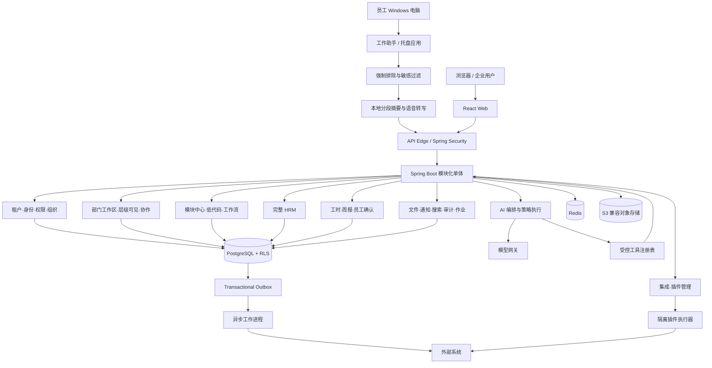

# AI 原生多租户企业应用管理 SaaS 正式产品与实施计划

> **For agentic workers:** 后续只有在本文件获得用户明确确认后，才可进入实现；实现时必须逐任务执行、测试、复核，不得跳过租户隔离、权限、审计与 AI 安全门禁。

**Goal:** 建设一套面向企业的、多租户 SaaS 形态的 AI 原生企业应用管理平台，既提供完整企业管理基础能力和完整 HRM，也允许企业通过低代码、插件与集成搭建业务应用，并允许 AI 在授权、风控和人工审批约束下实际执行工作。首批业务价值聚焦 AI 工时与周报：Windows 端在明确授权下读取工作软件内容，按固定或员工自定义间隔形成工作片段，结合语音补充生成工时草稿，并且只有员工本人确认后才能提交。

**Architecture:** 首个正式版本采用“Windows 工作助手 + 模块化单体主应用 + 独立异步工作进程 + 隔离插件执行器 + 模型网关”的架构。工作助手优先在本地执行应用排除、内容最小化、敏感信息过滤和分段摘要；业务数据使用 PostgreSQL 共享库、强制 `tenant_id` 与行级安全实现逻辑隔离；所有高风险动作统一经过策略决策、审批、幂等执行和审计回执。达到明确的容量、安全或团队边界后才拆分微服务。

**Tech Stack:** Windows 11、VS Code、Java 21、Spring Boot、Spring Modulith/Security、React、TypeScript、Vite、.NET 8 Windows 桌面助手、PostgreSQL、Flyway、Redis、S3 兼容对象存储、Docker/Docker Compose、OpenTelemetry。

**Spec:** 本文件同时是冻结的产品规格、架构规格和分阶段实施基线；不再另建会与其竞争的范围文档。

**版本：** Frozen 1.2.2（2026-11-09 勘误）。1.2.1 仅修正 §13.3 仓库结构（补 `backend/db/`、根级 `tests/`、补全模块注释）；1.2.2 将 Phase 2 由 6–7 周调整为 8–9 周，用于承接 §5.2 平台运营端与 §7.5 删除、保留及数据主体请求，总基线由 92–114 周相应上调为 94–116 周。产品范围、权限规则、风险边界与验收口径未变。决策依据见 `docs/adr/ADR-0001-repository-layout.md`。

## 全局约束

- 只在用户确认本计划后开始实现；本轮不创建工程、不安装依赖、不写应用代码、不改环境。
- 所有租户业务数据必须带 `tenant_id`；任何绕过租户上下文的访问都必须默认拒绝。
- 权限采用 RBAC、数据范围、属性条件和职责分离组合模型；“菜单可见”不能代替后端授权。
- AI 不直接访问数据库，不以系统管理员身份运行；AI 只能调用注册工具，并继承更窄的委托权限。
- 高风险操作必须人工审批；禁止通过提示词、插件或集成绕过审批、审计、幂等和数据权限。
- 工时助手只能在员工明确开启的工作时段采集；微信、QQ 及租户强制排除的社交软件在本地丢弃，管理员不得绕过；禁止键盘记录、持续录音和秘密开启采集。
- AI 只能生成工时草稿，不得自动提交；下班汇总必须由员工本人查看和确认，未确认草稿保留并在次日提醒。
- 数据库变更只通过 Flyway 前向迁移；已在生产执行的迁移文件不可修改。
- 对外 API 从 `/api/v1` 起步，遵守统一错误、分页、幂等、并发控制和版本兼容规则。
- 首期按一个全职个人开发者、AI 辅助、持续可演示交付来排期，不以微服务数量或功能页面数量衡量进度。

## 评审重点

1. 租户上下文缺失、伪造或跨租户对象 ID 被引用时，系统必须拒绝并形成安全日志。
2. 组织调整、离职、角色回收后，缓存权限、会话、API 令牌与 AI 委托必须及时失效。
3. 重复提交、重试、网络超时和回调乱序不能造成重复审批、重复发薪、重复写入或重复 AI 执行。
4. 低代码定义升级后，旧数据、运行中的流程、已发布页面和 API 合约必须保持可解释、可回滚。
5. 提示注入、恶意附件、越权工具选择和插件异常不能让 AI 扩大权限或泄露敏感数据。
6. Windows 工作助手必须在上传前执行社交软件排除和敏感信息过滤；服务端不得接收被禁止应用的窗口、正文、截图、音频或派生摘要。

---

## 1. 文档状态与冻结决定

### 1.1 状态

- 文档版本：1.2.2（Frozen，2026-11-09 结构与工期勘误）
- 产品代号：AIEOS（AI-native Enterprise Operating System）
- 范围状态：Frozen 1.2.2（产品范围仍为 1.2，用户已于 2026-11-09 确认部门工作区、层级可见、模块治理和可落地扩展；后续两次勘误仅调整 §13.3 目录结构与 Phase 2 工期，用户已确认）
- 计划基准日：2026-11-09
- 交付形态：多租户 Web SaaS；保留未来专属部署能力，但不在首期实现
- 目标客户：约 50–2,000 人的成长型和中型组织；架构不阻断更大客户，但首期不承诺超大型集团能力

### 1.2 已冻结的核心决定

| ID | 决定 | 理由 |
|---|---|---|
| D-001 | 产品是完整企业应用平台，不是以 project/agents/workflow 为中心的工具 | 项目、智能体和流程只是能力组件，不能代表整个平台 |
| D-002 | 同一产品包含内置企业模块、完整 HRM、低代码应用、插件和集成 | 满足“开箱即用”和“企业自行扩展”两类需求 |
| D-003 | AI 自主等级为“执行型” | AI 可完成真实写操作，但必须经过权限、风险分级、审批和审计 |
| D-004 | 首期采用模块化单体而非微服务 | 适合个人开发者，减少分布式事务和运维负担，同时保留模块边界 |
| D-005 | 多租户采用共享库/共享表逻辑隔离，PostgreSQL RLS 纵深防护 | 成本和可运维性最优；通过应用层与数据库层双重隔离降低风险 |
| D-006 | 低代码是声明式平台，不提供任意服务器代码执行 | 保证租户隔离、可升级性和安全性；复杂扩展通过隔离插件完成 |
| D-007 | AI、人工和服务账号都使用统一主体与授权模型 | 不给 AI 特权通道，所有行为可追责 |
| D-008 | HRM 包含薪酬计算与工资单，但不承诺各司法辖区的法定申报认证 | 保留完整 HR 业务闭环，同时控制地域合规不可控范围 |
| D-009 | 先稳定业务工具与审批，再开放 AI 写操作 | AI 执行依赖确定、幂等、可审计的业务 API |
| D-010 | 所有发布对象均版本化 | 低代码应用、流程、规则、提示词、插件配置和 AI 工具都可追溯、可回滚 |
| D-011 | AI 工时与周报助手是首批业务应用 | 先解决员工工作记录、主管审核和管理透明度，再扩展完整平台能力 |
| D-012 | 工作内容采集采用本地优先与强制排除 | 微信、QQ 等社交软件绝不采集；允许的工作软件按应用接口、可访问性接口或受控内容适配器读取，上传前最小化和脱敏 |
| D-013 | 工时只生成草稿，最终提交权属于员工本人 | 系统按小时或员工自定义间隔总结，下班汇总；未确认草稿次日提醒，AI、主管和管理员均不能代交 |
| D-014 | 每个部门拥有独立工作区，首页第一屏为成员与职位表 | 所有人先理解部门构成；普通员工只能进入本人工作页，主管可进入管理范围内下属工作页，老板可查看全公司已提交工作数据 |
| D-015 | 上下级可见性以生效中的汇报关系和管理范围为准 | 下级默认不能查看上级工作页，同级默认互不可见私有工作页；所有管理查看都由后端鉴权并留痕 |
| D-016 | 平台模块采用“积木式目录 + 受治理生命周期” | 模块可按公司、部门或项目安装；依赖、权限、版本、测试、启用、回滚和负责人均可追踪 |
| D-017 | 任何员工可发起模块需求，老板原则上最终批准和启用 | 发起人与上级沟通后提交，发起人在沙箱完成配置，老板审批后正式启用，避免未经治理的应用蔓延 |
| D-018 | 部门主管可在特殊情况下先行启用本部门模块 | 主管必须写明特殊情况、范围和影响；仅限本部门且高风险模块禁用该通道，启用后持续运行并等待老板无时限复核 |
| D-019 | 首发不一次性自研完整 ERP/CRM，而交付模块底座和三个参考模块 | 个人开发者先完成部门工作区、项目任务、知识与申请表单闭环，其余能力按 P1/P2 模块包扩展 |

### 1.3 范围分层

- **产品终态范围（本计划必须完成）：** 平台基础、部门工作区、AI 工时与周报、企业应用与模块中心、协同办公基础、完整 HRM、低代码、工作流与审批、集成、私有插件、执行型 AI、治理安全、运营管理。
- **首个可用版本：** 租户/IAM/组织、部门成员表和个人工作页、应用中心、审批/通知、手工工时与周报、主管审核、老板总览、管理看板和审计；AI 自动总结在下一阶段接入，手工填报始终作为兜底。
- **正式 GA：** 本计划全部 P0 能力达到验收标准；P1 能力可在 GA 后的增强波次交付，具体标识见功能树。
- **范围控制原则：** 终态范围不因分期而消失；分期只决定顺序，不代表省略。

## 2. 产品定义与 PRD

### 2.1 产品愿景

企业在一个统一的身份、组织、权限、数据、流程和 AI 治理底座上完成日常管理。标准业务直接使用内置模块；差异化业务通过低代码应用、集成和插件实现；AI 不只回答问题，而是在可证明的授权范围内查询、规划、发起审批、执行和回报结果。

### 2.2 要解决的问题

1. 企业系统分散，身份、组织、权限和审批重复建设，数据无法可靠贯通。
2. 通用 SaaS 难以覆盖企业差异化流程，传统定制开发周期长且难升级。
3. HR 数据和员工生命周期割裂，招聘、入职、考勤、薪酬、绩效等不能形成闭环。
4. 普通 AI 助手只能生成文本；可以执行的 AI 又容易越权、误操作且不可追责。
5. 企业缺少统一的应用目录、插件/集成治理、审计和生命周期管理。
6. 员工每天需要回忆并重复填写工时和周报，主管依靠人工催报；现有工具又容易演变为不透明的电脑监控，缺少员工确认、采集边界和隐私控制。
7. 部门成员、职位、工作沟通、文件、任务和工时散落在不同工具，员工进入系统后不知道“本部门是谁、谁负责什么、我的工作在哪里”。
8. 企业想增加业务功能时，要么依赖长期定制开发，要么让部门私自搭建应用，缺少统一申请、沙箱配置、审批、特殊启用、复核和退出机制。

### 2.3 目标用户与角色

| 角色 | 核心目标 |
|---|---|
| 平台运营管理员 | 管理租户、套餐、容量、平台健康和安全事件，不读取租户业务正文 |
| 租户所有者/管理员 | 初始化企业、域名、组织、策略、应用、集成和数据保留规则 |
| 安全/审计管理员 | 管理角色与职责分离，审计高风险操作、导出和 AI 行为 |
| HR 管理员/HRBP | 管理员工全生命周期、人才、薪酬、绩效、考勤和分析 |
| 部门经理 | 管理部门工作区、沟通、任务和文件；查看本人及管理范围内下属的工作页，审核员工已确认的工时与周报，不读取上级、未确认草稿或原始采集内容 |
| 企业老板/最高负责人 | 切换并查看所有部门、人员及已提交工作数据；原则上最终批准和启用模块，复核特殊启用；仍受审计、敏感域和未确认草稿边界约束 |
| 应用管理员/业务搭建者 | 创建低代码模型、页面、流程、权限、报表并发布版本 |
| 集成/插件管理员 | 管理连接器、密钥、Webhook、插件权限和运行状况 |
| 普通员工 | 开启或暂停工作助手，查看分段摘要、语音补充、修改工时草稿并本人确认提交，同时使用工作台、员工自助和 AI 助理 |
| AI 治理员 | 管理模型、工具、风险策略、预算、评测和停机开关 |
| 外部协作者（P1） | 在受限空间处理被邀请的表单、任务或审批，不进入企业内部数据域 |

### 2.4 顶级用户旅程

1. 企业注册或被平台创建后，租户管理员完成组织、域名、品牌和安全初始化。
2. 从应用中心启用 HRM、审批、公告等内置应用，并按部门分配可见性。
3. HR 导入员工，触发入职流程，自动创建账号、分配角色、任务和文档。
4. 业务管理员用低代码设计数据模型、表单、列表、流程和权限，经过测试后发布。
5. 集成管理员连接企业现有系统；事件通过 Webhook/连接器双向同步。
6. 员工在 Windows 工作助手中主动开始工作记录；客户端排除微信、QQ 等禁止应用，对允许的工作软件按小时或员工设置的间隔形成分段摘要。
7. 员工可以用语音补充会议、沟通或线下工作；下班时系统合并片段生成当日工时与周报素材，员工修改、确认后手动提交，未处理草稿次日提醒。
8. 主管审核员工已提交的工时和周报；管理层查看按时率、缺报、部门与项目投入，不得查看未确认草稿或原始工作正文。
9. 全员进入部门工作区先看到成员、职位和汇报关系表；员工只能打开自己的工作页，主管可打开本人和管理范围内下属工作页，老板可切换所有部门并查看已提交工作内容与授权文件。
10. 任一员工可提出新模块需求，与上级沟通后交老板审批；发起人在测试沙箱配置，老板正常批准启用。特殊情况由主管写明原因后可先在本部门启用，系统持续标记“特殊启用、待老板复核”。
11. AI 读取允许的数据，生成执行计划；低风险动作直接执行，高风险动作进入人工审批。
12. 审计员可还原“谁/哪个 AI、基于什么权限、调用了什么工具、改了什么、由谁批准”。

### 2.5 成功指标

| 类别 | 指标 | GA 目标 |
|---|---|---|
| 激活 | 新租户完成组织导入并启用首个应用 | 中位数 ≤ 1 个工作日 |
| 搭建 | 有经验管理员创建含模型、页面、权限、流程的应用 | ≤ 4 小时 |
| HR | 标准入职/转岗/离职流程数字化覆盖率 | 试点客户 ≥ 90% |
| 效率 | 常用审批从提交到完成的系统内闭环率 | ≥ 95% |
| 工时 | 试点员工日工时按时提交率 | 建议值 ≥ 95% |
| 周报 | 试点员工周报按时提交率 | 建议值 ≥ 95% |
| 工时安全 | 未经员工本人确认自动提交工时 | 0 次 |
| 采集隐私 | 微信、QQ 等强制排除应用内容上传服务端 | 0 条 |
| 部门入口 | 员工从部门首页找到本人工作页 | ≤ 2 次点击 |
| 层级权限 | 下级/同级越权读取他人私有工作页 | 0 次 |
| 模块交付 | 预置标准模板从老板受理到最终启用 | 中位数 ≤ 3 个工作日 |
| 特殊启用 | 越过部门范围或命中高风险禁用清单 | 0 次 |
| AI | AI 已执行动作中含完整授权与审计回执 | 100% |
| AI 安全 | 未经审批成功执行高风险动作 | 0 次 |
| 可靠性 | 月可用性（计划维护除外） | ≥ 99.9% |
| 性能 | 常规读 API p95 / 写 API p95 | ≤ 400 ms / ≤ 700 ms |
| 隔离 | 自动化跨租户越权测试通过率 | 100% |
| 质量 | GA 阻断级缺陷 | 0 个 |

### 2.6 非功能需求

- **容量基线：** 1,000 个活跃租户、200,000 个员工档案、2,000 并发在线用户；单租户默认 10,000 员工，可配置配额。
- **可靠性：** 核心事务 99.9% 月可用性；RPO ≤ 15 分钟，RTO ≤ 4 小时；季度恢复演练。
- **一致性：** 权限、员工状态、薪酬锁定和审批采用强一致事务；通知、搜索、报表和外部同步允许最终一致。
- **可访问性：** 核心员工自助和审批页面达到 WCAG 2.1 AA 的键盘、对比度与语义要求。
- **国际化：** 中文简体为首发界面；架构支持语言包、时区、币种、日期格式；英文列为 P1。
- **浏览器：** 支持发布时最新两个稳定版 Edge/Chrome；移动端采用响应式 Web，原生 App 不在首期。
- **数据保留：** 审计默认 7 年、业务日志默认 180 天、可配置但受合规下限限制；删除使用保留期和合法留置机制。
- **可观测性：** 请求、作业、流程、AI 执行和外部调用统一关联 ID；指标、日志、追踪不得记录明文秘密和高敏正文。

### 2.7 成熟产品对标与本方案取舍

对标用于验证产品原语，不代表复制界面或一次性承诺全部套件。选型结论如下：

| 对标实践 | 官方依据 | 本方案吸收 | 明确取舍 |
|---|---|---|---|
| Microsoft Teams 的标准、私有、共享频道及频道文件协作 | [Teams 团队与频道概览](https://learn.microsoft.com/en-us/microsoftteams/teams-channels-overview) | 部门全员频道、限定成员频道、跨部门协作空间；频道与文件权限分开判断 | 不自研即时聊天、音视频和 Office 协同编辑 |
| Microsoft Viva Insights 的个人信息私有、管理洞察聚合去标识及最小群组阈值 | [Microsoft Viva 隐私说明](https://learn.microsoft.com/en-us/viva/viva-privacy) | 未确认草稿仅本人可见；管理洞察默认聚合、去标识，平台最小群组阈值为 5 | 不以“效率评分”评价个人，不把工作助手原始数据用于纪律或自动绩效 |
| ServiceNow App Engine 的模板化低代码，以及数据、体验、逻辑、自动化和安全一体化 | [ServiceNow App Engine Studio 创建应用](https://www.servicenow.com/docs/r/application-development/app-engine-studio/create-application.html) | 模块模板、沙箱、数据模型、页面、流程、权限、测试、发布和治理作为同一生命周期 | 不允许运行任意服务器代码；复杂扩展进入隔离插件执行器 |
| Odoo 工时与项目/任务/工单关联、本人和全员范围分级 | [Odoo Timesheets](https://www.odoo.com/documentation/19.0/applications/services/timesheets.html) | 工时关联项目、任务和工单；个人、主管、老板按关系范围查看；网格/表格汇总 | AI 只建议工时，员工本人仍是唯一提交人 |
| Atlassian Confluence 的知识空间、模板和触发器/条件/分支/动作自动化 | [Confluence Automation](https://support.atlassian.com/confluence-cloud/docs/what-is-confluence-automation/) | 部门知识树、会议模板、内容到期复核、规则积木和执行审计 | 不把自动化规则变成绕过权限、审批或 AI 风险门禁的旁路 |
| 飞书开放平台的组织、工作台、多维表格、表单、仪表盘、自动化和开放集成 | [飞书开放平台概述](https://open.feishu.cn/document/client-docs/intro) | 部门工作台、表格化首屏、多视图、仪表盘、模块化入口和开放 API | 首版保持 Web 优先，不承诺复制完整 IM/云文档生态 |

据此，Frozen 1.2 的产品核心不是“多做几个固定菜单”，而是形成可复用的六个企业原语：组织关系、部门空间、工作记录、模块生命周期、权限/审批、可审计自动化。新增业务功能优先用这些原语组合，只有无法安全表达时才引入新底层能力。

## 3. 完整模块与功能树

标记：P0 = GA 必须完成；P1 = GA 后增强，但接口和数据模型在 P0 预留。

### 3.1 平台控制面（Platform Control Plane）

- 租户生命周期（P0）
  - 创建、试用、启用、冻结、注销、保留期、恢复
  - 套餐、配额、功能开关、使用量、账单计量数据
  - 租户域名、区域、品牌、默认语言/时区
- 平台运营（P0）
  - 租户健康、作业积压、集成失败、容量和安全告警
  - 受审批的支持访问；默认不可见租户业务数据
  - 平台公告、维护窗口、全局功能开关
- 商业化（P1）
  - 订阅、优惠、在线支付、发票；P0 仅计量和人工套餐管理

### 3.2 租户企业底座

- 身份与访问（P0）
  - 邮箱/手机号登录策略、密码、MFA、会话、设备、API 令牌
  - OIDC/SAML SSO、SCIM（P1；P0 预留身份提供商模型）
  - 用户、员工、外部协作者、服务账号、AI 主体
- 组织管理（P0）
  - 法人、组织单元、部门树、岗位、职务、职级、成本中心、地点
  - 主岗/兼岗、汇报线、矩阵团队、组织变更生效日期
- 权限中心（P0）
  - 系统/自定义角色、权限包、数据范围、条件策略、临时授权
  - 职责分离、委托、访问复核、授权变更审计
- 通用平台服务（P0）
  - 文件、评论、标签、收藏、关注、通知、搜索、导入导出
  - 任务/待办、审批、日历事件、模板、编号规则、字典
  - 审计日志、业务事件、异步作业、回收站、数据保留

### 3.3 部门工作区与协作

- 部门首页（P0）
  - 第一屏固定为表格：成员、职位、汇报层级、今日工时状态、周报状态、授权工作文件、工作页入口
  - 部门说明、负责人、目标、公告、常用入口和当日提醒；支持筛选、排序和按岗位分组
  - 普通员工能看本部门成员与职位，但仅本人行显示可进入的工作页；无权人员的工时、周报和文件显示为不可访问状态而非泄露摘要
- 个人工作页（P0）
  - 本人工时、周报、任务、目标、工作动态、获授权文件、会议行动项和历史提交
  - 员工仅访问本人；主管访问本人及生效管理范围内下属；老板访问全公司已提交工作数据
  - 未确认 AI 草稿、本地原始片段、薪酬、员工关系和其他高敏域继续使用各自更严格权限，不被“老板可看全部工作”隐式放开
- 部门沟通与内容（P0）
  - 公告频道、全员频道、限定成员频道、主题帖、评论、@提及、确认回执和置顶
  - 部门文件、版本、标签、分类、在线预览、引用到任务/周报；频道成员资格不自动扩大原文件权限
  - 部门知识库、会议纪要、决定记录、SOP、常见问题和内容到期复核
- 工作协同（P0）
  - 部门任务、看板、里程碑、负责人、截止期、依赖、会议与行动项；任务可关联项目、工时和周报
  - 跨部门协作空间使用显式成员和负责人，不因组织树关系自动开放；项目结束后归档并回收临时权限
- 管理分析（P0）
  - 提交率、逾期、项目/任务投入、工作负载和趋势；点击下钻仍按人员与文件权限判断
  - 涉及个人行为洞察的管理指标默认聚合、去标识，并设置最小群组人数阈值；不把未确认草稿用于排名或绩效
- 后续增强（P1）
  - 外部协作者、跨租户共享频道、移动端离线、协同编辑；即时聊天与音视频继续通过外部产品集成

### 3.4 企业应用与模块中心

- 应用/模块目录（P0）
  - 内置应用、自建应用、已安装插件应用、外部链接应用
  - 分类、搜索、收藏、最近使用、适用人群、负责人、模板、兼容版本和健康状态
  - 按公司、法人、部门、项目或团队安装；启用/停用、安装/卸载、版本、依赖、许可和数据处置
- 模块申请与配置（P0）
  - 全员可发起：业务问题、目标用户、所需数据、预期价值、风险、费用和建议负责人
  - 上级沟通/意见 → 老板受理 → 发起人沙箱配置 → 权限与影响预检 → 老板最终批准并启用
  - 发起人离职、转岗或失效前必须转移模块所有权、未决配置和支持责任
- 特殊启用（P0）
  - 部门主管填写特殊情况、紧迫性、适用范围、数据/权限、影响和退出方案后，可立即批准并仅在本部门启用
  - 状态持续显示“特殊启用、待老板复核”，立即通知并周期提醒老板；没有自动到期或自动停用
  - 老板后续可确认、要求修改、缩小范围或停用；所有历史和决定永久留痕
  - 薪酬、纪律人事、系统管理权限、敏感批量导出、外部系统写入和高风险 AI 模块禁止特殊启用
- 发布治理（P0）
  - 草稿、沟通中、待老板受理、配置中、测试中、整改中、测试失败、待最终批准、已驳回、已撤回、已启用、特殊启用待复核、暂停、已关闭、已弃用状态
  - 版本差异、影响分析、灰度范围、回滚、变更记录
- 门户与工作台（P0）
  - 我的待办、快捷入口、公告、日程、常用报表、AI 助理
  - 按角色/部门配置首页；部件级权限
- 首批参考模块（P0）
  - 项目与任务、部门知识与会议、通用表单与申请；三者必须证明目录、权限、安装、升级、停用和数据保留全生命周期
- 业务模块包（P1/P2）
  - P1：OKR、合同台账、费用报销、资产与领用、工单/服务台、客户与商机轻量版、供应商与采购申请
  - P2：库存轻量版、风险合规、培训扩展、调查问卷、电子签集成、行业模板；按真实客户需求排序
- 应用市场（P1）
  - 仅私有租户市场；公开第三方商业市场不在本计划范围

### 3.5 低代码应用构建器

- 数据模型（P0）
  - 文本、富文本、数字、金额、布尔、日期/时间、枚举、人员、部门、文件、地理位置、公式、自动编号
  - 一对一、一对多、多对多、自引用关系；必填、唯一、默认值、校验、索引
  - 系统字段、审计字段、软删除、记录归属、敏感级别
- 页面与视图（P0）
  - 表单、详情、表格、看板、日历、主从页面、仪表板
  - 条件显示、字段联动、只读/必填规则、动作按钮
  - 保存视图、筛选、排序、分组、聚合、导入/导出
- 业务规则与表达式（P0）
  - 无副作用表达式、校验规则、派生字段、编号、状态机
  - 规则测试、版本化、循环/复杂度限制
- 流程（P0）
  - 开始、人工任务、审批、条件、并行、定时器、服务任务、子流程、结束
  - SLA、催办、转交、加签、退回、撤回、委托、补偿
- 权限（P0）
  - 应用、模型、记录、字段、视图、动作权限
  - 记录归属、部门范围、共享、条件策略
- 生命周期（P0）
  - 开发/测试/生产环境语义、校验、发布快照、迁移、回滚
  - 测试数据与生产数据隔离；配置包导入导出
- 扩展组件（P1）
  - 经审核的自定义 UI 组件；沙箱 iframe、内容安全策略和能力声明

### 3.6 完整 HRM

- HR 核心（P0）
  - 员工主数据、人员编号、雇佣关系、合同、证件、紧急联系人、银行/税务字段
  - 入职、试用、转正、调动、晋升、借调、返聘、离职、再雇佣
  - 员工档案、附件、变更历史、批量导入、员工自助、经理自助
- 组织与职位（P0）
  - 编制、职位、岗位、职级、职务族、成本中心、汇报关系
  - 编制占用、空缺、组织快照、历史生效与未来变更
- 招聘 ATS（P0）
  - 招聘需求、职位发布、人才库、候选人、简历、面试、评价、Offer、录用转员工
  - 候选人隐私同意、重复识别、来源渠道、招聘漏斗
- 入转调离（P0）
  - 模板化清单、跨部门任务、材料签署状态、资产/账号交接、最后工作日
  - 与身份、组织、权限、薪酬、考勤和 AI 委托联动
- 考勤与排班（P0）
  - 班次、排班、工作日历、打卡导入、异常、补卡、加班、出差
  - 迟到早退/缺勤规则、周期结算、锁定、申诉
- 假勤（P0）
  - 假期类型、额度、累计/结转、请假、销假、证明材料、团队日历
- 薪酬（P0）
  - 薪资结构、项目、公式、薪资变更、一次性调整、周期、核算、复核、锁定
  - 考勤/绩效输入、税前税后项目、雇主成本、工资单、差异对比、补发/追溯
  - 通用可配置计算引擎；法定报税、银行代发通过集成输出，不宣称司法辖区认证
- 福利（P0）
  - 福利计划、资格、参保、公司/个人缴费、供应商文件、生命周期事件
- 绩效（P0）
  - 周期、目标/OKR、能力项、持续反馈、自评/上级/多方评价、校准、结果确认
- 薪酬规划（P0）
  - 调薪预算、建议、审批、矩阵、结果下发；与工资变更分离审批
- 学习发展（P0）
  - 课程、学习项目、报名、任务、完成、考试结果、证书、到期提醒
- 人才管理（P0）
  - 人才盘点、九宫格、继任计划、关键岗位、发展计划、保留风险（人工可解释）
- 员工关系（P0）
  - 申诉/事件、纪律措施、访谈记录、敏感访问控制、留痕
- HR 分析（P0）
  - 人数、流动、招聘、缺勤、薪酬、绩效、学习指标；口径版本化

### 3.7 AI 工时与周报助手

- Windows 工作助手（P0）
  - 员工主动开始、暂停和结束记录；托盘状态始终可见；支持私人模式和本日采集预览
  - 默认每 60 分钟生成工作片段，员工可配置允许范围内的分段间隔和下班汇总时间
  - 识别前台工作软件、窗口、文档、网页、代码仓库和任务上下文；深度内容读取优先使用应用 API、浏览器扩展和 Windows UI Automation 适配器
  - 不承诺所有第三方软件都能读取同等深度；无专用适配器时降级为窗口标题、可访问性文本和员工补充，不得通过键盘记录弥补
- 强制隐私边界（P0）
  - 微信、QQ 及租户强制排除的社交软件按进程、包标识、签名和窗口规则在本地拦截，相关正文、标题、图像、音频和派生摘要均不得上传
  - 禁止键盘记录、持续录音、隐藏运行、管理员远程秘密开启和绕过强制排除名单
  - 上传前执行密码、验证码、支付、证件、健康、薪酬和其他敏感信息过滤；员工可查看本地原始片段和删除派生草稿
- 分段总结与语音补充（P0）
  - 每个片段包含时间范围、候选项目/任务、工作摘要、建议有效工时、来源类型和 AI 置信度
  - 员工可以修改、合并、拆分、删除片段，或通过按键启动的语音输入补充会议、沟通和线下工作
  - 语音只在员工主动录入时采集，转写后进入同一敏感过滤与草稿流程，不持续监听
- 下班汇总与人工提交（P0）
  - 到员工设置的下班时间自动合并去重，生成当日工作总结、工时草稿和周报素材
  - AI 不得自动提交；只有员工本人可以确认和手动提交，主管和管理员不能代替确认
  - 未确认草稿持续保留，次日登录或开始工作时提醒；逾期可通知状态，但未确认正文对主管不可见
- 周报与管理（P0）
  - 周报从员工已确认的日工时、任务和语音补充汇总，员工补充问题与下周计划后手动提交
  - 主管审核、评论、退回；管理层查看按时率、缺报、部门与项目投入和异常趋势
  - 员工确认前的草稿及原始采集内容不得用于绩效、纪律或自动人事决定
- 后续增强（P1）
  - 空闲、阅读、会议和离开电脑时间的自动判定；跨设备采集；更多专业软件深度适配器

### 3.8 协同办公基础

- 公告、知识条目、评论与确认回执（P0）
- 通用申请/审批、待办、任务清单、提醒和日历（P0）
- 企业文件空间、目录权限、版本与外链控制（P0）
- 统一通知中心、企业搜索、收藏/最近访问、模板库、会议纪要和行动项（P0）
- 轻量项目/工作项作为首批参考模块（P0）；它是业务模块之一，不是整个平台核心
- 即时聊天、音视频会议仅做外部集成，不自研（范围外）

### 3.9 集成中心

- 连接器目录、连接实例、凭据引用、环境和负责人（P0）
- REST/Webhook、数据库只读同步、SFTP/文件交换、邮件发送（P0）
- 触发器、动作、字段映射、转换、去重、重试、死信、回放（P0）
- 出站 Webhook 签名、订阅范围、速率限制、交付日志（P0）
- OIDC/SAML/SCIM、主流 HR/财务/协作连接器按需求逐个增加（P1）

### 3.10 插件平台

- 插件清单：ID、版本、厂商、兼容范围、所需能力、权限、入口、迁移（P0）
- 安装、审批、配置、升级、禁用、卸载、回滚、健康检查（P0）
- 前端扩展在沙箱 iframe 运行；后端扩展在隔离执行器运行（P0）
- CPU、内存、时长、网络目标、文件和秘密访问配额（P0）
- 插件签名、恶意扫描、依赖清单、审计和停机开关（P0）
- 面向第三方的公共商业市场、结算和开放审核体系（范围外）

### 3.11 AI 中心

- AI 助理：问答、检索、总结、草拟、分析（P0）
- AI 工作委托：目标、范围、期限、预算、允许工具、禁止动作（P0）
- 工具注册与版本：输入/输出模式、权限、风险、幂等、补偿能力（P0）
- 执行计划：步骤、依据、预计影响、审批点、失败策略（P0）
- 动作执行：策略检查、审批、执行、验证、回执、补偿（P0）
- 模型与提示治理：供应商、路由、版本、模板、评测、费用、配额（P0）
- 企业知识检索：来源权限继承、引用、同步、删除传播（P0）
- AI 运营：任务队列、成功率、人工接管、风险事件、成本和质量分析（P0）
- 自主学习并自动修改生产规则/代码（范围外）

## 4. 详细功能规则

### 4.1 租户与企业初始化

1. 租户由平台运营创建或通过受控注册创建；首个用户成为租户所有者，但必须启用 MFA 后才能进行安全配置。
2. 初始化向导依次完成企业信息、时区/币种、组织根节点、管理员分工、登录策略、数据保留和首批应用。
3. 租户冻结后停止写业务数据和 AI 执行，保留所有者导出/申诉入口；注销经历申请、双人审批、冷静期、备份保留和最终删除。
4. 平台支持人员进入租户必须提供工单、目的、时限和审批；会话显著标识并全量审计，不允许隐式“万能管理员”。

### 4.2 组织与人员一致性

1. `User` 表示登录身份，`Person` 表示自然人，`Employment` 表示一段雇佣关系；三者不可合并，以支持无账号员工、再雇佣和一人多雇佣。
2. 部门、岗位、汇报线和雇佣变更具有 `effective_from/effective_to`；未来变更在生效作业中原子切换。
3. 离职生效时撤销会话、令牌、临时授权和 AI 委托，转移待办与记录归属，保留审计主体快照。
4. 组织树禁止环；移动部门前必须做权限、审批人、编制、报表和低代码规则的影响分析。

### 4.3 部门工作区与人员可见规则

1. 进入部门工作区默认落在“成员与职位”表，不以聊天流或统计看板替代；表格展示组织公开字段，私有工作字段按行、列和动作分别授权。
2. 工作页可见范围固定为：员工本人；当前生效汇报关系中的直接/间接下属；明确、限时的管理委派；老板全租户工作域。下级对上级、同级对同级、非管理部门默认拒绝。临时项目成员只能访问该项目内的任务、文件和已提交工时投影，不能进入他人的完整工作页。
3. “老板可查看所有人”只覆盖已提交工时/周报、授权任务、工作内容和工作文件，不覆盖员工未确认草稿、本地原始采集、私人频道、薪酬、银行、员工关系等独立高敏域。
4. 主管范围由生效中的实线汇报链和明确的管理委派计算；虚线汇报、代管和跨部门项目必须声明可查看的资源、时间和范围，不自动继承全部人员权限。
5. 部门频道分为全员、限定成员和跨部门三类。帖子权限继承频道成员，文件权限单独判断；从频道移除人员时同时检查直接分享链接，避免残留访问。
6. 主管和老板打开他人工作页、预览/下载文件、导出、批量查询和下钻分析都记录审计；员工可在权限允许范围看到“谁查看了我的已提交工作数据”的访问记录。
7. 人员调动或汇报线变更后，旧部门内容按记录归属与保留策略处理，人员权限在 60 秒内失效；禁止通过缓存、搜索索引、旧链接或导出文件继续访问。
8. 管理分析涉及个人洞察时，默认仅对不少于 5 人的群组显示聚合结果；租户可提高阈值但不能降低平台隐私下限。该阈值只限制聚合洞察，不阻止主管/老板按本节权限打开单个员工已提交记录。

### 4.4 模块申请、配置、启用与退出

1. 任何在职成员都可提交模块建议；必填业务问题、目标、范围、数据、权限、成本、收益、负责人建议和替代方案。发起人与直属上级沟通后，上级记录意见但不能替代老板的正常最终批准。
2. 老板受理后，发起人成为临时配置负责人，在与生产数据隔离的沙箱使用模板或低代码完成配置；测试数据不得直接复制高敏生产正文。
3. 正常启用顺序为：建议 → 上级沟通 → 老板受理 → 发起人配置 → 自动预检 → 业务验收 → 应用管理员批准技术制品进入可安装目录 → 老板最终批准具体范围安装启用。应用管理员不能以“技术发布”替代老板的业务启用批准。
4. 特殊情况下，部门主管提交原因、紧迫性、适用部门、使用期限建议、数据分类、权限、外部影响、负责人和退出方案后，可立即批准并启用；实际范围被服务端强制锁定在主管管理的本部门。特殊启用只能选择已经技术发布、版本不可变、依赖完整、迁移预检、安全扫描、权限差异、最小自动测试和回滚点均通过的制品；它只跳过老板事前业务批准，不跳过任何技术或安全门禁。
5. 特殊启用没有强制复核时限，不自动停用。系统持续标记并提醒老板；老板复核后可确认、修改/缩小范围、转入正常审批或停用，不能删除原特殊启用记录。
6. 特殊启用禁用清单包含薪酬/付款、纪律或高影响 HR 决定、角色/系统管理权限、C3 批量导出、外部系统写入、公开发布、插件新增网络/秘密能力和 R3/R4 AI 动作；命中时只能走老板事前批准。
7. 每次启用生成不可变安装版本、权限清单、数据范围、负责人、依赖和回滚点；升级新增权限或扩大范围必须重新批准，不能沿用旧批准。
8. 模块负责人离职或转岗前必须完成所有权转移；无人接管时模块转为只读/受管状态。停用需明确数据导出、保留、删除、依赖和未结流程处置。
9. 模块风险由系统策略计算，申请人和主管只能补充说明，不能降低结果：M0 为只读展示且仅用 C0/C1 数据；M1 为部门内可逆写入且不含外部写入；M2 为跨部门、C2 数据、复杂迁移、插件能力或难完全回滚；M3 为 C3 数据、薪酬付款、纪律人事、系统权限、敏感导出、外部系统写入、公开发布或 R3/R4 AI。特殊启用仅允许 M0/M1，M2/M3 必须老板事前批准。
10. 状态机至少包含 `DRAFT → CONSULTING → AWAITING_ACCEPTANCE → CONFIGURING → TESTING → CHANGES_REQUESTED / TEST_FAILED / AWAITING_FINAL_APPROVAL → ACTIVE`，并允许进入 `REJECTED`、`WITHDRAWN`、`SPECIAL_ACTIVE_PENDING_REVIEW`、`SUSPENDED`、`CLOSED`、`DEPRECATED`。每个转换定义主体、前置条件、幂等键、通知和审计，不允许跳状态写库。
11. 企业老板/最高负责人是独立业务角色，租户所有者或管理员不自动获得业务正文权限。租户必须保持至少一名有效受托人；角色为空时正常启用阻断。若老板本人是发起人或配置负责人，由另一名获授权最高负责人最终批准。
12. 无时限待复核不等于无条件持续运行。发生租户冻结、数据泄漏、恶意代码、越权、依赖漏洞或其他明确安全事件时，安全管理员可立即暂停并保全证据，同时通知老板；不得仅因复核等待时间长而自动暂停。

### 4.5 应用安装与发布

1. 应用安装创建带明确 `scope_type/scope_id` 的公司、法人、部门、项目或团队范围实例和默认配置，不隐式向所有人授权。
2. 每次发布形成不可变 `AppRelease`，绑定模型、页面、流程、规则、权限模板和依赖版本。
3. 发布前执行模式校验、依赖检查、权限差异、数据迁移预检、安全扫描和自动化验收；应用管理员批准技术制品进入可安装目录，老板或受限的特殊流程批准具体范围的生产安装与启用。
4. 回滚回到上一配置版本；若含不可逆数据变更，只能使用前向修复迁移并在界面明确提示。

### 4.6 低代码运行规则

1. 元数据与业务记录分离存储；发布版本不可直接编辑，修改从新草稿分支开始。
2. 表达式使用白名单函数，无网络、文件、反射或任意代码能力；限制执行时间、递归深度和依赖环。
3. 记录写入顺序为：认证 → 租户 → 授权 → 模式校验 → 业务规则 → 事务写入 → outbox 事件。
4. 动态字段级权限同时作用于页面、API、导出、搜索索引和 AI 上下文；隐藏字段不得通过错误信息或聚合泄露。
5. 模型删除先进入弃用状态；存在记录、关系、流程或报表依赖时禁止物理删除。

### 4.7 HRM 关键规则

1. 员工敏感字段按分级加密；薪酬、证件、银行信息默认仅 HR 特权角色可见，经理权限不自动包含。
2. 招聘候选人与员工数据域分离；录用转换保留来源关系但按最小必要原则复制数据。
3. 考勤周期锁定后，修改必须走更正单并生成差异，不覆盖原始计算结果。
4. 薪酬计算以不可变输入快照运行；核算、复核、批准、发布工资单必须职责分离。
5. 工资单发布与银行代发分离；系统生成受控付款文件或集成请求，但自动放款属于最高风险动作。
6. 绩效校准和员工关系案件采用独立数据域与更严格的访问审计。
7. HR 报表指标记录口径版本、统计时点和过滤范围，禁止把实时数与历史快照混算。

### 4.8 通用审批与工作流

1. 流程定义发布后不可变；运行实例固定引用版本，新版本只影响新实例。
2. 审批人解析支持人员、岗位、部门负责人、汇报链、角色和表达式；解析为空时进入异常队列，不自动通过。
3. 同一人不能同时满足互斥职责；发起人自批、薪酬制单与复核、权限申请与批准默认禁止。
4. 超时可提醒、升级、转交或失败，但不得以超时默认批准高风险动作。
5. 每个服务任务必须声明幂等键、超时、重试、补偿和人工处理入口。

### 4.9 AI 工时与周报规则

1. 工作助手首次启用必须展示采集目的、允许的数据、强制排除应用、保留期和员工控制权；员工未主动开始记录时不得采集。
2. 微信、QQ 等强制排除应用在客户端最早阶段识别并丢弃。排除规则由平台签名发布，租户只能增加排除项，不能删除平台最低排除项。
3. 允许应用按“专用适配器 → Windows UI Automation/可访问性文本 → 窗口元数据”逐级降级；不使用键盘记录、持续屏幕录像或持续麦克风监听补足内容。
4. 每个时间片只保存形成工时草稿所需的最小证据摘要，标记来源和置信度。员工可修改、合并、拆分、删除或标记私人内容。
5. 语音输入必须由员工按键或点击启动，界面持续显示录音状态；转写后执行同样的敏感信息过滤，原始音频按短期策略删除。
6. 下班汇总只产生草稿。提交接口要求员工本人当前会话、草稿版本和明确确认；AI、主管、管理员、服务账号及批量作业均不得调用代交路径。
7. 未确认草稿保留并在次日提醒。主管只能看到“未提交/逾期”状态，不能看到草稿正文、分段记录或原始采集内容。
8. 员工提交后，主管按规则审核、评论或退回。退回只创建新草稿版本，不覆盖原提交内容。
9. 原始内容默认本地短期保存并在提交或到期后删除；服务端保存最小化片段、员工确认后的工时、周报和必要审计。具体保留期由租户策略配置且需隐私评估。
10. 空闲、阅读、会议和离开电脑时间的自动判定不进入首版验收；首版允许员工调整建议工时并记录修改原因。

## 5. 信息架构与页面导航

### 5.1 租户端主导航

| 一级导航 | 二级页面 | 主要角色 |
|---|---|---|
| 工作台 | 我的首页、待办、已办、我的申请、日程、快捷入口、AI 助理 | 全员 |
| 部门 | 部门切换、成员与职位表、我的工作页、沟通频道、任务看板、文件、知识、会议、部门分析 | 全员；主管/老板按管理范围增加入口 |
| 工时与周报 | 今日时间线、分段摘要、语音补充、当日草稿、历史工时、周报、填报状态；主管审核与管理看板 | 员工/经理/管理层按权 |
| 应用与模块 | 目录、收藏、最近使用、内置/自建/插件应用、模块建议、我的配置、待老板审批、特殊启用待复核、安装与健康 | 全员/发起人/主管/老板/应用管理员 |
| 人力资源 | HR 首页、员工、组织职位、招聘、入转调离、考勤、假勤、薪酬、福利、绩效、调薪、学习、人才、员工关系、分析 | HR/经理/员工按权 |
| 协同 | 公告、知识、文件、任务、通用申请 | 全员 |
| AI 中心 | 对话、工作委托、执行记录、待我审批、知识源、工具、模型与预算、评测与风险 | 全员/AI 管理员 |
| 搭建中心 | 我的应用、数据模型、页面、流程、规则、报表、权限、测试、发布 | 应用搭建者 |
| 集成与插件 | 连接器、连接实例、Webhook、同步作业、插件、密钥引用、运行日志 | 集成管理员 |
| 管理中心 | 企业信息、组织、账号、角色权限、安全、字典、编号、通知、审计、数据管理、套餐用量 | 租户管理员 |

导航项依据权限隐藏，但直接访问路由仍必须由后端鉴权。员工自助页面与 HR 管理页面使用不同路由和权限包，避免仅靠字段隐藏区分。

### 5.2 平台运营端导航

- 运营总览：租户数、活跃度、容量、错误率、AI 成本、集成健康。
- 租户管理：生命周期、套餐、配额、功能开关、域名、支持访问。
- 平台目录：内置应用版本、连接器、插件签名、模型供应商。
- 安全运营：异常登录、跨租户阻断、秘密轮换、漏洞和事件。
- 作业与审计：迁移、备份、恢复演练、异步队列、平台级审计。
- 平台设置：邮件、对象存储、模型网关、全局限制；不在此展示租户业务正文。

### 5.3 关键页面约束

- 列表统一支持权限感知搜索、保存视图、批量动作、导出申请和字段配置。
- 详情页统一展示主信息、关联、活动时间线、附件、评论、权限可见的审计摘要。
- 高风险按钮使用风险说明、影响预览、二次确认或审批，而非仅使用颜色警告。
- AI 执行页必须显示目标、使用数据、计划步骤、权限来源、审批状态、成本、结果和回滚状态。
- 工时草稿页必须区分“本地原始片段、AI 建议、员工修改、正式提交”四种状态，显示采集开关、排除应用、来源和置信度；任何提交按钮都必须由员工本人主动触发。
- 部门首页成员表的默认列为成员、职位、汇报层级、今日工时、周报、工作文件和工作页；姓名与职位可见不等于工作内容可见，无权单元格不得返回摘要、数量或可猜测链接。
- 模块详情必须展示状态、适用范围、负责人、数据与权限、依赖、版本、审批链、特殊启用原因、待复核标记、审计和停用影响；高风险禁用清单命中时隐藏特殊启用动作并解释原因。

## 6. 系统架构

### 6.1 总体逻辑架构



### 6.2 部署单元

1. **Web：** React 静态资源，由反向代理/CDN 提供。
2. **API 应用：** Spring Boot 主进程；处理同步业务请求，不执行长耗时插件或模型调用。
3. **Worker：** 与主应用共享模块和数据库，通过独立启动配置消费 outbox、通知、同步、报表、流程定时器和 AI 作业。
4. **Plugin Runner：** 独立容器和网络策略，执行经批准的插件动作；无数据库直连。
5. **Model Gateway：** 统一模型供应商、路由、脱敏、配额、日志和停机控制；可先作为进程内模块，GA 前形成独立安全边界。
6. **Windows Work Assistant：** .NET 8 托盘应用与受控后台组件；负责显式开始/暂停、应用识别、强制排除、本地内容读取、敏感过滤、分段摘要、语音输入和加密本地缓存。客户端无租户管理权限，只能上传当前员工自己的最小化片段。
7. **数据设施：** PostgreSQL 为事实源；Redis 仅用于短期缓存、限流、锁和队列提示，不作为事实源；对象存储承载文件。

### 6.3 后端模块边界

| 模块 | 责任 | 禁止事项 |
|---|---|---|
| tenancy | 租户生命周期、配额、功能开关 | 不读取业务正文 |
| identity | 用户、认证、会话、MFA、令牌 | 不保存员工业务档案 |
| organization | 法人、部门、岗位、汇报关系 | 不决定登录策略 |
| authorization | 权限、策略、数据范围、委托 | 不依赖前端菜单判断 |
| department | 部门空间、成员表、工作页投影、频道、部门任务/知识/会议 | 不复制组织主数据；不绕过文件、工时和高敏域权限 |
| appcatalog | 应用/模块目录、建议、配置负责人、安装、特殊启用、复核、发布与版本 | 不直接执行任意插件代码；不把特殊启用扩大到部门外 |
| lowcode | 元数据、动态记录、页面/规则运行时 | 不绕过统一权限和审计 |
| workflow | 定义、实例、任务、审批、SLA | 不内嵌具体 HR 业务规则 |
| hr | 全部 HRM 领域能力 | 不自行实现账号/权限底座 |
| worklog | 工作片段、工时草稿、周报、本人确认、主管审核、提醒和统计 | 不接收强制排除应用内容；不允许 AI、主管或管理员代替员工提交 |
| collaboration | 公告、知识、通用任务/申请 | 不扩张为即时通信平台 |
| integration | 连接、映射、同步、Webhook | 不持有明文秘密 |
| plugin | 插件清单、安装、权限、运行调度 | 不在 API 进程加载不可信代码 |
| ai | 委托、计划、工具、策略、执行、评测 | 不直接访问数据库或扩大权限 |
| platform | 文件、通知、搜索、审计、作业、字典 | 不承载领域特有状态机 |

模块间通过公开应用服务和领域事件交互；禁止跨模块直接访问内部表。同步事务只覆盖强一致边界；跨模块副作用使用事务 outbox，消费者必须幂等。

### 6.4 多租户隔离

- 租户通过已验证域名/子域名或登录后的租户选择确定；`X-Tenant-Id` 只能作为已认证上下文提示，不能单独决定租户。
- 应用层在每次事务开始设置租户上下文；PostgreSQL RLS 根据受控会话变量限制行。
- 所有唯一约束以 `(tenant_id, business_key)` 组成；外键在可行时包含 `tenant_id`，防止跨租户引用。
- 平台控制面与租户业务面的数据库角色分离；迁移账号、运行账号、只读分析账号权限不同。
- 缓存键、对象存储路径、搜索文档、作业、日志关联和导出文件均包含租户隔离维度。
- 自动测试必须尝试已知/随机他租户 UUID、批量接口、搜索、导出、附件 URL、WebSocket/SSE 和 AI 工具。

### 6.5 一致性与异步处理

- 业务写入和 outbox 事件在同一数据库事务提交。
- Worker 采用“至少一次”处理；消费者通过事件 ID/业务幂等键去重。
- 外部调用记录请求摘要、响应摘要、重试次数、下次时间和最终状态；敏感正文脱敏。
- 指数退避后进入死信；管理员可查看影响、修复配置并安全回放。
- 长作业提供进度、取消、超时和结果文件；取消不能破坏已提交的原子事务。

### 6.6 可演进策略

只有满足以下任一条件才拆服务：独立扩容收益明确；法规要求独立数据边界；插件/模型调用需要更强隔离；单模块发布频率明显阻塞主应用；团队所有权已经形成。首选拆分顺序是插件执行器、模型网关、集成 Worker、报表，而不是核心 HR 事务。

## 7. 数据库与 ER 设计

### 7.1 数据设计规范

- 主键使用时间有序 UUID；业务编号与主键分离，不向外暴露数据库序列规律。
- 租户表公共字段：`id`、`tenant_id`、`created_at`、`created_by`、`updated_at`、`updated_by`、`version`；需要软删除时增加 `deleted_at/deleted_by`。
- 时间统一以 UTC 存储，显示时使用租户/用户时区；纯业务日期使用 `date`，不得误用时间戳。
- 金额使用定点数并显式存储币种；比率/精度由字段定义固定，不使用浮点数。
- 高敏字段使用信封加密；可检索敏感字段保存独立盲索引，密钥版本随密文记录。
- JSONB 仅用于有明确模式版本的扩展属性、发布快照和外部原始载荷；核心关系、权限和统计维度不得全部塞入 JSONB。
- 审计事件只追加，不允许业务角色更新/删除；大表按时间和租户策略分区并归档。

### 7.2 核心实体关系图

```mermaid
erDiagram
  TENANT ||--o{ TENANT_MEMBER : has
  USER ||--o{ TENANT_MEMBER : joins
  PERSON ||--o{ EMPLOYMENT : holds
  TENANT_MEMBER o|--o| PERSON : links
  LEGAL_ENTITY ||--o{ EMPLOYMENT : employs
  ORG_UNIT ||--o{ ORG_UNIT : contains
  ORG_UNIT ||--o{ POSITION : owns
  POSITION ||--o{ POSITION_ASSIGNMENT : assigned
  EMPLOYMENT ||--o{ POSITION_ASSIGNMENT : occupies
  ORG_UNIT ||--|| DEPARTMENT_SPACE : owns
  DEPARTMENT_SPACE ||--o{ DEPARTMENT_CHANNEL : contains
  DEPARTMENT_CHANNEL ||--o{ CHANNEL_MEMBERSHIP : limits
  DEPARTMENT_CHANNEL ||--o{ CHANNEL_POST : contains
  EMPLOYMENT ||--o{ PERSON_WORK_PAGE : has

  ROLE ||--o{ ROLE_PERMISSION : grants
  PERMISSION ||--o{ ROLE_PERMISSION : included
  TENANT_MEMBER ||--o{ ROLE_ASSIGNMENT : receives
  ROLE ||--o{ ROLE_ASSIGNMENT : assigned
  ROLE_ASSIGNMENT }o--o| DATA_SCOPE : constrained_by

  APPLICATION ||--o{ APP_RELEASE : versions
  APPLICATION ||--o{ APP_INSTALLATION : installed_as
  APPLICATION ||--o{ MODULE_REQUEST : proposed_as
  MODULE_REQUEST ||--o{ MODULE_CONFIG_DRAFT : configures
  MODULE_REQUEST ||--o| SPECIAL_ACTIVATION : may_activate
  APP_INSTALLATION ||--o{ INSTALLATION_REVIEW : reviewed
  APP_RELEASE ||--o{ MODEL_DEFINITION : contains
  MODEL_DEFINITION ||--o{ FIELD_DEFINITION : contains
  MODEL_DEFINITION ||--o{ DYNAMIC_RECORD : instantiates
  DYNAMIC_RECORD ||--o{ RECORD_VALUE : contains
  WORKFLOW_DEFINITION ||--o{ WORKFLOW_VERSION : versions
  WORKFLOW_VERSION ||--o{ WORKFLOW_INSTANCE : runs
  WORKFLOW_INSTANCE ||--o{ WORK_ITEM : creates

  EMPLOYMENT ||--o{ ATTENDANCE_PERIOD_RESULT : produces
  EMPLOYMENT ||--o{ LEAVE_REQUEST : requests
  PAYROLL_CYCLE ||--o{ PAYROLL_RUN : calculates
  PAYROLL_RUN ||--o{ PAYROLL_RESULT : contains
  EMPLOYMENT ||--o{ PAYROLL_RESULT : receives
  PERFORMANCE_CYCLE ||--o{ PERFORMANCE_REVIEW : contains
  EMPLOYMENT ||--o{ PERFORMANCE_REVIEW : subject

  EMPLOYMENT ||--o{ WORK_ACTIVITY_SEGMENT : owns
  EMPLOYMENT ||--o{ WORKLOG_DRAFT : owns
  WORKLOG_DRAFT ||--o{ WORKLOG_DRAFT_ITEM : contains
  WORKLOG_DRAFT ||--o| WORKLOG_SUBMISSION : confirmed_as
  WORKLOG_SUBMISSION ||--o{ WORKLOG_REVIEW : reviewed_by
  EMPLOYMENT ||--o{ WEEKLY_REPORT : submits

  AI_DELEGATION ||--o{ AI_RUN : authorizes
  AI_RUN ||--o{ AI_ACTION : plans
  AI_ACTION }o--|| AI_TOOL_VERSION : invokes
  AI_ACTION ||--o| APPROVAL_REQUEST : may_require
  AI_ACTION ||--o| EXECUTION_RECEIPT : produces
  AUDIT_EVENT }o--|| ACTOR : attributed_to
```



### 7.3 表族与关键字段

#### A. 平台、身份与组织

| 表/聚合 | 关键字段 | 关系与约束 |
|---|---|---|
| `tenant` | code, name, status, region, timezone, locale, plan_id | code 全局唯一；状态机受控 |
| `tenant_domain` | tenant_id, domain, verified_at, purpose | 域名全局唯一，验证后启用 |
| `tenant_feature` / `tenant_quota` | feature_key, value/effective_at | 变更审计；配额不能低于已用量而无处置 |
| `user_account` | login identifiers, status, auth_version | 身份标识规范化；秘密不存明文 |
| `tenant_member` | tenant_id, user_id, person_id, status | `(tenant_id,user_id)` 唯一 |
| `session` / `mfa_method` / `api_token` | subject, scope, expires_at, revoked_at | 保存令牌摘要；可单独撤销 |
| `legal_entity` | legal_name, registration_no, currency | 注册号按租户/地区唯一 |
| `org_unit` | parent_id, type, code, effective dates, path | 禁止环；路径用于快速范围查询 |
| `job_profile` / `position` | job family, grade, headcount, org_unit_id | 职位可空缺；编制可版本化 |
| `person` | legal/preferred name, contacts, encrypted IDs | 自然人与登录账号解耦 |
| `employment` | person_id, legal_entity_id, employee_no, status, dates | 同一雇佣编号在租户唯一 |
| `position_assignment` | employment_id, position_id, primary, allocation, dates | 同期仅一个主岗；比例校验 |
| `reporting_line` | manager_employment_id, type, dates | 禁止环；支持实线/虚线 |

#### B. 授权、治理与通用服务

| 表/聚合 | 关键字段 | 关系与约束 |
|---|---|---|
| `actor` | type(user/service/ai/system), reference_id, status | 所有审计行为的统一主体 |
| `permission` | resource, action, sensitivity | 平台定义、稳定键 |
| `role` / `role_permission` | role type, permission_id, effect | 系统角色不可删除；拒绝优先 |
| `role_assignment` | actor_id, role_id, scope_id, valid_from/to | 临时授权必须到期 |
| `data_scope` | type, org roots, owner rule, filter expression | 表达式需编译和版本化 |
| `policy` / `policy_version` | condition, effect, priority, status | 发布版本不可变 |
| `delegation` | grantor, grantee, permissions, scope, expiry | 不可超出授予者可委托范围 |
| `separation_rule` | conflicting permissions/roles, enforcement | 分配和执行时双重检查 |
| `approval_request` / `approval_step` | object, risk, approver rule, status | 快照保留审批依据和参与者 |
| `file_object` / `file_link` | storage_key, hash, scan_status, classification | 下载再次鉴权；文件可复用但链接分权 |
| `notification` / `delivery_attempt` | channel, template, target, status | 发送幂等、可退订规则 |
| `audit_event` | actor, action, resource, before/after digest, trace_id | 只追加、完整性链、敏感脱敏 |
| `outbox_event` / `inbox_receipt` | type, aggregate, payload_version, status | 生产与消费幂等依据 |
| `async_job` | type, parameters_ref, progress, result_ref | 大参数/结果放对象存储 |

#### C. 部门工作区与协作

| 表/聚合 | 关键字段 | 关系与约束 |
|---|---|---|
| `department_space` | org_unit_id, name, owner, status, default_layout | 一个有效部门对应一个空间；组织调整保持历史引用 |
| `department_space_member` | space_id, employment_id, membership_type, dates | 从组织主数据投影；临时/跨部门成员显式到期 |
| `person_work_page` | employment_id, home_org_id, layout_version, status | 只保存页面配置与聚合引用，不复制工时/HR 正文 |
| `department_channel` | space_id, type, name, owner, visibility | 全员/限定成员/跨部门；类型变更做影响预检 |
| `channel_membership` | channel_id, employment_id, role, valid_to | 限定/跨部门频道显式成员；退出立即撤权 |
| `channel_post/comment` | channel_id, author, content_ref, state, version | 编辑保留版本；删除按保留与审计规则 |
| `department_task/milestone` | space_id, assignee, status, due_at, work_ref | 可关联项目、工时、会议和周报 |
| `department_knowledge/page_version` | space_id, tree_path, owner, review_at | 发布版本与到期复核；搜索继承 ACL |
| `meeting/action_item` | space_id, attendees, decision_ref, due_at | 会议纪要、决定和行动项可追踪 |
| `department_file_link` | space/channel/task, file_object_id, access_policy | 文件对象与空间链接分离；下载再次鉴权 |
| `management_insight_snapshot` | scope, metric_version, period, min_group_size | 仅聚合授权数据；小群体抑制 |

#### D. 应用、模块、低代码与流程

| 表/聚合 | 关键字段 | 关系与约束 |
|---|---|---|
| `application` | key, type, owner, lifecycle, current_release | key 在租户内唯一 |
| `app_release` | semantic_version, manifest, checksum, status | 发布后不可变；记录依赖 |
| `app_installation` | tenant_id, app/release, scope_type/scope_id, owner, activation_mode, policy_snapshot, enabled_by/at, restrictions, config, status | 同范围+模块+有效版本唯一；内置应用也按实例治理 |
| `module_request` | optional_application_id, initiator, business_case, target_scope, data_classes, declared_risk, policy_risk, state | 可先提出尚不存在的模块；系统风险不可被申请人降低 |
| `module_consultation` | request_id, manager, opinion, discussed_at | 记录上级沟通；不等同最终批准 |
| `module_config_draft` | request_id, owner, sandbox_id, config_version, test_result | 与生产数据隔离；发起人配置，可转移负责人 |
| `special_activation` | request_id, installation_id, immutable_release_id, manager, reason, urgency, scope_snapshot, gate_result, restrictions | 仅本部门；只允许已发布且技术门禁通过的 M0/M1 版本 |
| `installation_review` | special_activation_id, installation_id, state, reviewer, decision, conditions, decided_at | pending/confirmed/changed/disabled；老板无时限复核，历史不可删除 |
| `module_review_reminder` | review_id, schedule_policy, last_sent_at, next_send_at, delivery_status | 只提醒不自动作出决定 |
| `module_ownership_transfer` | request_id/installation_id, from/to, reason, effective_at | 离职/转岗/失效前必须完成 |
| `model_definition` / `field_definition` | stable_key, type, constraints, sensitivity | stable_key 跨版本稳定 |
| `relation_definition` | source/target, cardinality, delete behavior | 发布前检查环和级联风险 |
| `page_definition` / `view_definition` | layout_schema, query_schema, version | 引用字段必须存在且有权 |
| `rule_definition` | trigger, condition, action, version | 无副作用表达式与受控动作 |
| `dynamic_record` | model_id, release_id, owner, state, version | 元数据列 + 记录主体；支持乐观锁 |
| `record_value` | record_id, field_id, typed values | 按类型使用专列/索引，不以单个 JSONB 兜底 |
| `record_relation` | relation_id, source_id, target_id | 三方 tenant_id 一致 |
| `record_share` | record_id, grantee, access, expiry | 不可授予超出分享者权限 |
| `workflow_definition/version` | key, graph, validation, checksum | 版本不可变 |
| `workflow_instance` | version_id, business_ref, state, variables | 业务引用含租户/类型/ID |
| `work_item` | instance_id, assignee rule/result, due_at, state | 认领/完成使用乐观锁 |
| `service_task_attempt` | node, idempotency_key, outcome | 重试不重复产生业务副作用 |

#### E. HRM

| 领域 | 主要表/聚合 |
|---|---|
| 人事档案 | `employee_profile`, `employment_contract`, `employee_document`, `employee_change`, `emergency_contact` |
| 生命周期 | `lifecycle_case`, `lifecycle_task`, `onboarding_template`, `offboarding_clearance` |
| 招聘 | `requisition`, `job_posting`, `candidate`, `candidate_consent`, `application`, `interview`, `interview_feedback`, `offer` |
| 考勤 | `work_calendar`, `shift`, `schedule`, `time_punch`, `attendance_rule`, `attendance_period`, `attendance_result`, `attendance_correction` |
| 假勤 | `leave_type`, `leave_policy`, `leave_account`, `leave_transaction`, `leave_request` |
| 薪酬 | `pay_component`, `salary_structure`, `employee_compensation`, `payroll_cycle`, `payroll_run`, `payroll_input_snapshot`, `payroll_result`, `payslip` |
| 福利 | `benefit_plan`, `benefit_eligibility`, `benefit_enrollment`, `benefit_contribution` |
| 绩效 | `performance_cycle`, `goal`, `review_template`, `performance_review`, `review_response`, `calibration_session`, `performance_result` |
| 调薪 | `comp_review_cycle`, `comp_budget`, `comp_proposal`, `comp_approval`, `comp_change` |
| 学习 | `course`, `learning_program`, `learning_assignment`, `enrollment`, `completion`, `certificate` |
| 人才 | `talent_review`, `talent_rating`, `succession_plan`, `successor`, `development_plan` |
| 员工关系 | `employee_case`, `case_event`, `disciplinary_action`, `case_access_grant` |

所有 HR 计算结果保留输入快照、规则版本、计算批次和人工调整来源。候选人、员工关系、薪酬分别设置独立权限域；通用“HR 管理员”也不默认拥有所有高敏域。

#### F. AI 工时与周报

| 表/聚合 | 关键字段 | 关系与约束 |
|---|---|---|
| `work_assistant_device` | employment_id, device_public_key, app_version, policy_version, status, last_seen_at | 仅登记设备和策略状态，不保存管理员远程控制能力；可撤销 |
| `capture_policy/version` | forced_exclusions, tenant_exclusions, adapters, retention, summary_interval | 平台强制排除项不可被租户删除；发布版本签名且可审计 |
| `work_activity_segment` | employment_id, started_at, ended_at, source_types, app_category, sanitized_evidence, confidence, local_ref | 仅保存最小化证据；禁止应用标识或正文命中即拒绝写入 |
| `work_reference` | type(generic_task/external_task/free_tag/project_task), source_id, label, access_snapshot | Phase 4 不依赖正式项目模块；Phase 6 后可绑定项目实体 |
| `voice_note` | employment_id, recorded_at, transcript, audio_retention_until, classification | 必须由员工主动录入；原始音频短期保存或本地即删 |
| `worklog_draft` / `worklog_draft_item` | work_date, version, project/task refs, summary, suggested_minutes, employee_adjustment, state | 草稿仅本人可见；支持合并、拆分、删除；版本不可覆盖 |
| `worklog_submission` | draft_version, employee_confirmed_at, submitted_at, totals, content_snapshot | 只能由员工本人当前会话创建；确认快照不可变 |
| `worklog_review` | submission_id, reviewer, decision, comment, decided_at | 主管审核、退回和评论；不能修改原提交快照 |
| `weekly_report` | week, confirmed_worklog_refs, achievements, issues, next_plan, state | 只引用已确认工时；员工本人手动提交 |
| `worklog_reminder` | target_date, reminder_type, sent_at, delivery_status | 未确认草稿次日继续提醒；主管只见状态不见草稿正文 |

本地原始内容不进入数据库事实表。服务端接收请求时再次执行禁止应用标识、敏感模式和策略版本校验；命中时拒绝并记录不含正文的安全事件。

#### G. 集成、插件与 AI

| 表/聚合 | 关键字段 | 关系与约束 |
|---|---|---|
| `connector_definition/version` | capabilities, schemas, risk | 平台签名版本 |
| `connection` | owner, credential_ref, environment, status | 仅保存秘密引用 |
| `integration_flow/version` | trigger, mapping, actions | 发布后不可变 |
| `sync_run` / `sync_item` | cursor, counts, outcome, error category | 支持重试、回放与对账 |
| `webhook_subscription/delivery` | event filters, target, secret_ref, attempts | HMAC、去重、限流 |
| `plugin_package/version` | manifest, checksum, signature, SBOM | 安装前验证 |
| `plugin_installation/grant` | config, permissions, network allowlist | 升级重新评估新增权限 |
| `ai_model_endpoint` | provider, model, region, policy, price | 密钥使用引用 |
| `knowledge_source/document/chunk` | ACL snapshot, classification, embedding ref | 删除与权限变更传播到索引 |
| `ai_tool/tool_version` | schema, permission, risk, idempotency, compensator | 版本不可变；执行前再授权 |
| `ai_delegation` | principal, goal scope, tools, data scope, budget, expiry | AI 权限不大于委托人 |
| `ai_run` | objective, context refs, policy version, state, cost | 完整关联链 |
| `ai_plan/ai_action` | sequence, tool version, input digest, risk, approval | 计划与实际差异可见 |
| `execution_receipt` | outcome, effects, verification, rollback ref | 结果可验证、可导出 |
| `ai_evaluation` / `ai_incident` | suite/version/score, severity, response | 上线门禁和事故复盘 |

### 7.4 索引、分区与归档

- 常用索引首列包含 `tenant_id`；软删除表的唯一约束使用部分索引排除已删除行。
- `audit_event`、`outbox_event`、通知交付、集成明细、AI 事件按月分区；归档前生成校验清单。
- 组织路径、审批待办、员工状态、动态记录常用筛选建立针对性索引，禁止在未观测前批量添加索引。
- 动态记录的高频筛选字段可在发布时申请物化索引；建立前评估租户配额、基数和写放大。
- 报表读取只读副本或刷新后的数据集；核心事务查询不得直接运行无限制的自定义聚合。

### 7.5 数据删除与可恢复性

- 普通删除进入回收站，默认 30 天；法律留置、工资结果和审计不允许普通删除。
- 个人信息删除请求先识别法定义务、业务关系和备份传播；可匿名化的标识替换后保留统计事实。
- 备份加密、跨故障域保存；每季度从备份恢复到隔离环境并验证租户、附件、密钥版本和迁移一致性。

## 8. API 与事件契约

### 8.1 通用约定

| 项目 | 约定 |
|---|---|
| 基础路径 | `/api/v1`；平台控制面使用 `/platform/api/v1` 且独立认证域 |
| 格式 | JSON UTF-8；文件使用预签名分段上传，完成后病毒扫描 |
| 身份 | 浏览器使用安全 Cookie/OIDC 会话；机器使用短期 OAuth2 客户端凭据 |
| 租户 | 从已认证会话和验证域名解析；客户端声明与会话不一致时拒绝 |
| 关联 | `X-Request-Id`；服务生成 `trace_id` 并返回 |
| 幂等 | 写入外部副作用的端点要求 `Idempotency-Key`；同键不同请求体返回冲突 |
| 并发 | 资源返回 `ETag`/版本；更新要求 `If-Match`，冲突返回 412 |
| 分页 | 游标分页 `page[size]`、`page[after]`；默认 20、最大 200 |
| 查询 | 白名单字段筛选/排序；复杂报表走异步作业，不开放任意 SQL |
| 错误 | RFC 7807 Problem Details，含稳定错误码、字段错误、request_id，不泄露内部堆栈 |
| 速率限制 | 按租户、主体、端点和风险分层；返回标准限流头与重试时间 |
| 版本 | 兼容性新增不升主版本；删除字段先弃用并至少保留两个发布周期 |

### 8.2 资源端点清单

| 领域 | 代表性契约 |
|---|---|
| 认证 | `POST /auth/login`、`POST /auth/mfa/verify`、`POST /auth/logout`、`GET /me`、会话撤销 |
| 租户 | `GET/PATCH /tenant`、域名验证、品牌、安全配置、配额与用量 |
| 组织 | `/legal-entities`、`/org-units`、`/positions`、`/reporting-lines`；变更支持生效日期和影响预览 |
| 身份权限 | `/members`、`/roles`、`/role-assignments`、`/policies`、`/delegations`、`/access-reviews` |
| 部门工作区 | `/department-spaces`、成员与职位表、`/people/{employmentId}/work-page`、频道/成员/帖子、部门任务、知识、会议、文件和权限感知分析 |
| 应用与模块中心 | `/applications`、`/app-installations`、`/app-releases`、发布预检、灰度、回滚；`/module-requests`、上级沟通、沙箱配置、业务验收、老板批准/启用 |
| 特殊启用 | `POST /module-requests/{id}/special-activate`、`GET /module-reviews/pending`、老板确认/修改范围/停用；服务端强制部门范围和高风险禁用清单 |
| 低代码元数据 | `/builder/apps/{appId}/models|pages|views|rules|workflows`；草稿与发布版本分离 |
| 动态数据 | `/data/{appKey}/{modelKey}/records`；字段、动作、导出均按已发布模式授权 |
| 工作流 | `/workflow-definitions`、`/workflow-instances`、`/work-items`、审批/转交/退回/撤回 |
| 工时助手设备 | `POST /work-assistant/devices/register`、策略拉取、设备撤销、版本与健康；不提供远程秘密开启采集接口 |
| 工时与周报 | `/worklogs/activity-segments`、`/worklogs/drafts`、片段合并/拆分/删除、本人确认提交、主管审核/退回、`/weekly-reports`、提醒与管理看板 |
| 语音补充 | `POST /worklogs/voice-notes` 或本地转写后提交文本；原始音频上传必须受租户策略、短期保留和员工确认约束 |
| HR 核心 | `/hr/people`、`/hr/employments`、`/hr/employee-changes`、`/hr/contracts` |
| 招聘 | `/hr/requisitions`、`/hr/candidates`、`/hr/applications`、`/hr/interviews`、`/hr/offers` |
| 时间与薪酬 | `/hr/attendance-periods`、`/hr/leave-requests`、`/hr/payroll-runs`、复核/锁定/工资单发布 |
| 人才模块 | `/hr/performance-cycles`、`/hr/comp-reviews`、`/hr/learning`、`/hr/talent-reviews` |
| 文件与审计 | `/files/uploads`、`/files/{id}/download`、`/audit-events`、`/exports` |
| 集成 | `/connections`、`/integration-flows`、`/sync-runs`、`/webhooks`、重放与对账 |
| 插件 | `/plugins/catalog`、`/plugin-installations`、权限预览、升级、禁用、健康 |
| AI | `/ai/delegations`、`/ai/runs`、`/ai/runs/{id}/plan`、批准/拒绝/取消、动作与回执 |

### 8.3 关键动作契约

- **影响预览：** 组织移动、应用发布、权限变更、批量 HR 变更、薪酬发布和 AI 高风险动作必须先提供 `preview`，返回影响数量、警告、所需审批和不可逆项。
- **工作页读取：** `GET /people/{employmentId}/work-page` 不接受客户端传入“主管”标记；服务端按当前生效汇报图、委派、资源类型和敏感级别逐项求值。无权时返回统一 403/404 策略，不返回统计数量、文件名或草稿状态细节。
- **模块正常启用：** 只有请求进入 `AWAITING_FINAL_APPROVAL`，技术制品已由应用管理员发布，且沙箱测试、权限差异、依赖、数据迁移、安全扫描、负责人和回滚检查通过，老板主体才能调用最终启用；启用请求携带配置摘要和 `If-Match`。
- **模块特殊启用：** 主管提交结构化理由和范围；服务端重新计算 M0–M3 风险，校验主管管理范围、M0/M1 限制、不可变技术发布、依赖/迁移/安全/测试/回滚门禁和安装范围，再原子写入特殊启用、安装版本、待复核、提醒、审计与老板通知。重复调用使用幂等键，不扩大原范围。
- **老板事后复核：** 复核没有到期自动决定；老板可确认、附条件确认、缩小范围、要求修改或停用。修改权限/范围生成新版本并再次预检，旧审计保持不可变。
- **批量写：** 接受不超过配置上限的命令列表，支持全有或逐项结果两种显式模式；默认不允许部分成功。
- **导入：** 上传 → 扫描 → 解析 → 字段映射 → 预检 → 用户确认 → 异步执行 → 错误文件；确认前不写业务表。
- **导出：** 提交异步作业，做权限快照和高敏审批；结果文件短期有效、带水印并记录每次下载。
- **审批：** 决策请求携带当前任务版本；已处理、已撤销或权限变化返回确定状态，不能重复决定。
- **AI 执行：** 创建运行只提交目标；系统返回计划版本。批准绑定计划摘要，计划实质变化后原批准失效。
- **工时片段：** 客户端提交设备、策略版本、时间范围、来源类别和已脱敏证据摘要；服务端再次检查禁止应用与敏感模式，同一设备/时间片使用幂等键去重。
- **员工确认提交：** `POST /worklogs/drafts/{id}/submit` 必须携带草稿版本、确认声明和当前员工会话；如果主体不是草稿所属员工、版本已变化或存在未确认冲突，返回拒绝或 412。不存在管理员、主管、AI 或服务账号代交端点。

### 8.4 领域事件

事件名使用过去时态与版本，如 `hr.employment.terminated.v1`。事件信封固定包含 `event_id`、`event_type`、`occurred_at`、`tenant_id`、`actor_id`、`aggregate_type/id/version`、`trace_id`、`payload_version`。首批事件包括：

- `tenant.activated/suspended`
- `identity.member.invited/activated/disabled`
- `organization.unit.moved`、`organization.assignment.changed`
- `department.space.created`、`department.channel.membership.changed`、`department.work_page.viewed`
- `app.release.published`、`app.installation.changed`
- `module.request.submitted/accepted/configured/approved`、`module.special_activation.enabled/reviewed/disabled`
- `workflow.instance.started/completed/failed`
- `hr.employment.hired/transferred/terminated`
- `hr.attendance.period.locked`、`hr.payroll.run.approved/published`
- `worklog.segment.summarized/discarded`、`worklog.draft.created/reminded/confirmed/submitted/returned`
- `weekly_report.draft.created/submitted/reviewed/returned`
- `integration.sync.completed/failed`
- `ai.run.started/waiting_approval/completed/failed`
- `ai.action.executed/compensated/blocked`

事件载荷只含消费者需要的最小数据；高敏正文使用授权后可读取的资源引用。Schema 变更先向后兼容，消费者按版本注册。

### 8.5 Webhook

- 每次交付使用时间戳、唯一交付 ID 和 HMAC-SHA256 签名；接收方需防重放。
- 2xx 视为成功；408/429/5xx 指数退避，其他 4xx 进入暂停/人工处理。
- 至少一次交付，顺序不保证；事件包含聚合版本供接收方排序和去重。
- 管理员可查看脱敏请求、响应、重试和签名时间，但不能查看连接秘密。

## 9. 权限模型

### 9.1 决策公式

一次访问必须同时满足：

`认证有效 ∧ 租户匹配 ∧ 主体有效 ∧ 功能已启用 ∧ 存在允许权限 ∧ 数据范围命中 ∧ 条件策略通过 ∧ 无显式拒绝 ∧ 无职责分离冲突 ∧ 风险门禁通过`。

默认拒绝；显式拒绝优先；平台管理员不自动成为租户管理员；AI、服务账号和插件均为独立主体。

### 9.2 权限粒度

- 资源：租户、组织、部门空间、频道、人员工作页、部门任务/知识/会议、应用、模块请求、特殊启用、模型、记录、字段、流程、工资、文件、工时草稿、工时提交、周报、采集策略、工作助手设备、集成、插件、AI 工具等。
- 动作：查看、列出、创建、更新、删除、导入、导出、提出、配置、批准、特殊启用、事后复核、发布、执行、委托、管理权限。
- 数据范围：本人、本人创建、直接下属、汇报链下属、指定部门、部门及子部门、被管理委派、指定项目/协作空间、指定法人、记录共享、全租户。
- 条件：雇佣状态、记录状态、敏感级别、金额阈值、工作时间、设备信任、网络、地域、风险等级。
- 字段：允许查看/编辑/导出/用于 AI；字段拒绝不能被记录级允许覆盖。
- 工时专属范围：员工本人可查看和编辑未提交草稿；主管仅能看团队提交状态及员工已提交内容；管理层查看聚合指标。安全管理员可审计策略和拒绝事件，但默认不能读取原始工作正文。
- 工作页专属范围：普通员工仅本人；主管为本人加当前生效管理范围内下属；老板为全租户工作域。组织公开的姓名/职位与私有工作内容使用不同权限，不能用前者推导后者。
- 模块专属范围：全员可提出；只有受理后的配置负责人可改沙箱配置；正常生产启用由老板批准；主管的特殊启用仅限其本部门且受高风险禁用清单约束；老板事后复核不允许篡改原审计。

### 9.3 内置角色基线

平台运营管理员、平台安全管理员、租户所有者、企业老板/最高负责人、租户管理员、安全管理员、审计员、HR 核心管理员、薪酬管理员、招聘管理员、考勤管理员、绩效管理员、部门主管、模块配置负责人、应用管理员、应用搭建者、集成管理员、AI 治理员、普通员工、外部协作者。内置角色是模板，可复制收窄；高权限内置角色不可静默扩大。

### 9.4 职责分离

- 租户所有者与平台支持访问审批者不得为同一主体。
- 权限申请者不能批准自己的高权限授权。
- 薪酬制单、复核、批准和付款导出至少分为两人，推荐三人。
- 插件上传/签名与租户安装审批分离。
- AI 工具开发/注册、风险评级和生产启用至少需要独立复核。
- 模块正常启用的发起/配置与最终批准分离；特殊启用允许主管在部门范围内兼任批准者，但必须结构化说明、自动通知老板并进入事后复核队列。
- 审计员只读且不能清除审计；安全管理员不能修改自己的审计记录。

### 9.5 权限生命周期

- 角色分配可设置生效/失效时间和申请依据；高权限默认限时。
- 组织/职位驱动授权在变更生效后自动重算；旧授权和相关缓存立即撤销。
- 每季度生成高权限访问复核；逾期未确认按策略暂停或升级。
- 权限模拟器解释“为什么允许/拒绝”，但输出本身受安全权限控制，避免泄露策略结构。

## 10. AI 执行、治理与安全

### 10.1 执行闭环

AI 的标准执行链固定为：

1. **接受委托：** 明确目标、委托人、租户、有效期、数据范围、工具、预算和禁止事项。
2. **检索上下文：** 仅获取委托人当前有权访问且允许用于 AI 的数据，附来源与版本。
3. **形成计划：** 列出步骤、工具版本、输入摘要、预计影响、风险等级、审批点和失败策略。
4. **策略决策：** 每个动作执行前重新检查主体状态、权限、数据范围、职责分离、配额与风险。
5. **人工审批：** 达到门槛时冻结计划摘要；审批人查看业务影响和敏感数据使用情况。
6. **幂等执行：** 仅调用已注册的确定性业务工具；工具自身再次执行后端授权。
7. **结果验证：** 读取业务结果或校验事件，不能仅根据模型文字判断成功。
8. **回执与补偿：** 记录实际变化、异常、成本和可用补偿；失败时停止后续依赖步骤。
9. **持续评测：** 将匿名化结果进入离线评测和策略改进；不得自动修改生产规则。

### 10.2 风险等级

| 等级 | 定义 | 默认处理 | 示例 |
|---|---|---|---|
| R0 | 只读、低敏、无外部副作用 | 授权内可自动 | 查本人待办、总结公开公告 |
| R1 | 可逆、单对象、低影响写入 | 明确委托后可自动，保留撤销 | 新建草稿、添加个人任务、更新非敏感偏好 |
| R2 | 多对象或中等业务影响 | 执行前显示计划；按租户策略审批 | 批量提醒、安排面试、创建部门内流程实例 |
| R3 | 高敏、权限、人员、财务、外部发布或难逆 | 强制人工审批，部分场景双人审批 | 员工调动、薪酬变更、批量导出、生产应用发布 |
| R4 | 法律/安全不可接受或本产品不应自主执行 | 永久禁止，只能给建议 | 关闭审计、绕过权限、删除备份、自动银行放款、自动解雇决定 |

AI 生成或修改工时草稿属于 R1；员工本人提交工时不是 AI 动作，而是独立的人机确认门禁。任何自动提交、主管代交、管理员代交或通过批量作业代交均按 R4 永久禁止。

风险取工具固有风险、数据敏感度、对象数量、金额、可逆性、外部影响和上下文异常的最高结果。租户可以收紧，不能低于平台最低等级。

### 10.3 高风险强制人工控制

- 创建/提升管理员、修改安全策略、关闭 MFA、生成长期令牌。
- 入职/转岗/离职正式生效，尤其是自动停用账号或取消权限。
- 薪酬计算批准、工资单发布、付款文件/代发请求、福利大额变更。
- 大批量修改/删除、敏感导出、外部分享、生产低代码应用发布。
- 安装或升级新增权限的插件、扩大连接器网络/数据范围。
- 以企业名义向外部发送正式消息、Offer、合同或纪律通知。

审批绑定动作内容摘要、工具版本和权限快照；对象数量、金额、收件人、字段或工具版本变化均使批准失效。

### 10.4 AI 工具契约

每个工具版本必须声明：稳定工具 ID、用途、结构化输入/输出、所需权限、支持的数据范围、风险基线、是否幂等、幂等键算法、最大批量、超时、重试策略、可逆性、补偿工具、结果验证方式、数据分类、日志脱敏规则和负责人。没有这些信息的工具不能进入生产。

工具不得接受任意 SQL、任意 URL、任意脚本或“以管理员身份执行”参数。对象 ID 必须在工具内部按租户重新加载和授权，不能信任模型提供的对象属性。

### 10.5 模型与知识治理

- 模型端点按数据分类、地域、成本、能力和可用性路由；高敏数据只能发往获批端点。
- 默认不允许供应商使用租户输入训练；合同和配置证明纳入端点登记。
- 发送前最小化上下文并脱敏；模型日志不保存秘密、完整证件号、银行号或工资明细。
- 知识检索继承源 ACL；用户权限撤销、源文件删除或分类提升后，索引和缓存必须传播失效。
- 回答展示引用、来源时间和不确定性；无可用来源时明确说明，不伪造企业事实。
- 提示模板、系统策略、工具说明和评测集全部版本化，变更经过测试与审批。

### 10.6 提示注入和工具滥用防护

- 把网页、附件、邮件和知识文档视为不可信数据，不把其中指令提升为系统命令。
- 模型提出的工具调用先经过独立策略引擎，不允许模型自行判定授权。
- 外部 URL 访问只经受控抓取器和域名白名单，阻止内网、元数据服务和 DNS 重绑定。
- 文件先做类型识别、病毒扫描、大小限制和内容隔离；插件输出同样视为不可信。
- 检测目标漂移、异常批量、敏感字段枚举、审批诱导和重复失败；触发暂停与人工接管。

### 10.7 AI 运营与紧急停止

- 平台、租户、应用、工具四级停机开关；关闭后阻止新动作并安全终止未执行步骤。
- 限额包括每日调用、token、金额、动作数、批量对象数和并发数。
- 运营指标包括完成率、工具失败率、人工驳回率、计划变更率、补偿率、单位任务成本和安全事件。
- AI 事故保留完整链路，支持封禁端点/工具/插件、撤销委托、回滚可逆动作和通知受影响人员。

### 10.8 工时总结专用治理

- 工作片段总结只能使用本地强制排除和敏感过滤后的内容；模型网关不得接收微信、QQ 等禁止应用数据。
- 每个草稿项显示来源类别、时间范围和置信度，使员工能够判断 AI 为什么得出该结论；不得把 AI 猜测写成确定事实。
- 项目、任务和工时均为建议值。员工修改、删除和语音补充不需要主管批准，但正式提交形成不可变快照。
- 下班汇总、次日提醒和逾期状态可以自动触发；提交动作始终要求员工本人当前会话中的显式确认。
- 主管、管理员和 AI 治理员无权查看员工未确认草稿；模型评测优先使用合成或明确授权数据，不把员工工作正文默认加入训练集。

## 11. 安全、隐私与合规设计

### 11.1 安全基线

- 采用 OWASP ASVS L2 作为 Web/API 验收基线，关键认证和高敏操作按更高要求检查。
- 全链路 TLS；生产数据库、备份、对象存储和秘密加密；密钥与数据分离并定期轮换。
- 密码使用现代自适应哈希；高权限强制 MFA；支持会话并发限制、风险登录和设备撤销。
- CSRF、XSS、SQL 注入、SSRF、路径穿越、恶意文件、反序列化和供应链风险均有自动化测试。
- 前端使用严格 CSP、可信来源、SameSite/HttpOnly/Secure Cookie；不把令牌放入长期浏览器存储。
- 所有依赖、容器和插件生成 SBOM；持续扫描已知漏洞、许可证和秘密泄漏。

### 11.2 数据分类

| 级别 | 示例 | 最低控制 |
|---|---|---|
| C0 公开 | 企业公开公告、公开职位 | 完整性、发布审批 |
| C1 内部 | 普通流程、组织公开信息 | 租户认证、最小权限 |
| C2 机密 | 合同、绩效、候选人资料、业务记录 | 字段权限、导出控制、加密、访问审计 |
| C3 高敏 | 薪酬、证件、银行、健康/纪律、秘密 | 字段加密、特权角色、强审批、水印、全量访问审计、AI 端点限制 |

低代码字段创建时必须选择分类或继承模型默认值；分类降级需安全管理员审批。

### 11.3 秘密与凭据

- 应用数据库只保存秘密管理器引用和元数据，不保存第三方凭据明文。
- 连接测试由后端完成，界面只显示掩码；秘密读取不可通过普通 API 返回。
- 秘密轮换支持双版本过渡；插件和 AI 工具仅获得短期、用途受限的能力令牌。

### 11.4 审计

审计记录包含主体、代理主体、租户、来源、时间、动作、资源、结果、策略/权限依据、请求/追踪 ID、变更摘要和风险等级。查看薪酬/员工关系、高敏导出、权限模拟、支持访问和 AI 上下文读取都属于审计事件，而不只记录写操作。

审计存储使用追加权限、周期哈希链和外部归档校验；业务管理员不可删除。导出审计时再次审计，并依据权限脱敏。

### 11.5 隐私

- 收集目的、法律依据/同意、保留期、共享范围和数据主体请求可配置和可追踪。
- 招聘候选人同意与员工雇佣处理依据分开；同意撤回触发限制处理或删除评估。
- 数据访问、更正、导出、删除请求通过案件流程处理，保留义务优先于普通删除。
- 生产数据禁止复制到开发环境；测试使用合成或不可逆匿名化数据。
- 工作助手实施前完成员工监测与个人信息影响评估，并依据适用法律、劳动规则和企业制度确定告知、同意或其他处理基础；不能用产品配置替代法律评估。
- 采集状态必须持续可见，员工可暂停、进入私人模式、查看当天片段并删除未提交草稿；管理员不得隐藏托盘状态或远程秘密启用。
- 微信、QQ 等平台强制排除应用在客户端即丢弃。租户可增加排除项，不能减少；排除规则更新需签名、版本化和审计。
- 禁止键盘记录、持续屏幕录像和持续麦克风监听。深度内容读取应优先使用应用 API、浏览器扩展和可访问性接口，并限制为形成工作摘要所需的最小范围。
- 本地原始内容和语音原始音频采用短期保留，提交或到期后删除；服务端保存最小化证据、员工确认后的内容和必要审计，主管默认不可访问原始内容。

### 11.6 安全运维

- 开发、测试、生产账号和秘密分离；生产变更使用审批和可追溯发布。
- 数据库迁移先在恢复副本演练；关键迁移提供运行时估算、锁评估、备份点和前向修复方案。
- 安全事件分级、通知、隔离、证据保全、恢复和复盘有标准手册；每半年桌面演练。
- 上线前进行威胁建模、依赖扫描、SAST、DAST、权限矩阵测试和外部渗透测试。

## 12. 技术选型与工程约束

### 12.1 后端

| 能力 | 选择 | 说明 |
|---|---|---|
| 语言 | Java 21 | LTS，使用记录类、密封类型等稳定特性，禁用预览特性作为核心依赖 |
| 框架 | Spring Boot（实施启动时锁定一个仍受安全支持且兼容 Java 21 的小版本） | 具体补丁版本写入依赖锁定与 ADR，不在文档中追逐“最新” |
| 模块化 | Spring Modulith + Maven 多模块 | 验证模块依赖、领域事件和集成测试；不等同微服务 |
| 安全 | Spring Security、OAuth2/OIDC Resource Server/Client | 自建业务授权层处理 RBAC/ABAC/数据范围 |
| 数据访问 | Spring Data JPA 用于稳定聚合；jOOQ/JdbcClient 用于复杂查询和批处理 | 禁止动态拼接 SQL；低代码查询由受控编译器生成 |
| 数据库 | PostgreSQL + RLS；可选 pgvector | 事务事实源、全文检索起步；向量扩展仅承载检索索引 |
| 迁移 | Flyway | 每次发布前向迁移、校验和不可变 |
| 缓存/协调 | Redis | 短缓存、限流、分布式锁提示；不能替代数据库正确性 |
| 对象存储 | S3 API；本地 MinIO，生产使用受支持服务 | 文件、导入导出、报表、归档 |
| API | REST/OpenAPI 3.1；SSE 用于进度事件 | 首期不引入 GraphQL，减少授权面 |
| 作业 | 数据库 outbox + Worker；必要时后续引入消息中间件 | 个人开发阶段降低设施复杂度 |
| AI | Spring AI 或薄模型适配层 + 自有策略/工具编排 | 避免把供应商 SDK 泄露到业务模块 |

### 12.2 前端

| 能力 | 选择 | 说明 |
|---|---|---|
| 基础 | React + TypeScript 严格模式 + Vite | SPA，模块路由懒加载 |
| 路由/请求 | React Router、TanStack Query | 服务端状态与 UI 状态分离 |
| UI | Ant Design（主题封装） | 企业后台组件成熟；建立本产品设计 token |
| 表单 | React Hook Form + Zod | 低代码运行时另有模式解释层，服务端仍为最终校验 |
| 表格/可视化 | 先用 UI 库表格与 Apache ECharts | 超大数据使用服务端分页，禁止浏览器全量加载 |
| 状态 | URL + Query Cache 为主，Zustand 仅用于有限跨页 UI 状态 | 避免全局状态复制服务端事实 |
| 测试 | Vitest、Testing Library、Playwright | 单元/组件/端到端分层 |
| 契约 | OpenAPI 生成类型化客户端 | 生成代码不手改，CI 检查契约漂移 |

### 12.3 Windows 工作助手

| 能力 | 选择 | 说明 |
|---|---|---|
| 桌面技术 | .NET 8 + Windows App SDK/WinUI 3 | 作为 Java + React 主栈的受控例外；更适合 Windows 托盘、设备身份、UI Automation 和企业部署 |
| 应用识别 | 进程/包标识、代码签名、窗口类、Windows UI Automation | 强制排除判断在内容读取之前执行；未知应用先按租户策略降级或暂停深度读取 |
| 深度适配 | Edge/Chrome 扩展、Office 接口、VS Code 扩展、文件/任务系统适配器 | 专用适配器只返回形成摘要所需内容；适配器按版本、权限和风险签名发布 |
| 本地安全 | DPAPI/Windows Credential Manager、设备密钥、签名更新、加密缓存 | 不保存平台管理员凭据；设备丢失或离职后可撤销上传能力 |
| 本地 AI | 可插拔的本地摘要与敏感过滤；必要时经模型网关调用获批模型 | 首先执行排除与脱敏，再决定是否上传；离线时可暂存片段并显示状态 |
| 语音 | 员工按键启动录音，本地或获批端点转写 | 不持续监听；原始音频短期保留或本地即删 |
| 部署 | MSIX/企业软件分发，签名安装包和渐进升级 | 提供回滚、版本最低线、健康检查和紧急停用采集策略 |

### 12.4 质量与运维工具

- 后端：JUnit 5、AssertJ、Testcontainers、ArchUnit/Modulith 验证、REST Assured。
- 数据：Flyway 校验、真实 PostgreSQL 集成测试、迁移升级/回退演练（业务回退使用前向修复）。
- 可观测：OpenTelemetry、Micrometer、Prometheus 兼容指标、结构化日志、集中追踪。
- 质量门禁：格式化、静态分析、依赖/容器扫描、覆盖率趋势、OpenAPI diff、数据库迁移校验。
- 容器：多阶段镜像、非 root 用户、只读根文件系统（可行处）、健康检查、资源限制和签名。
- Windows 助手：xUnit、Windows App SDK 测试、适配器契约测试、签名/升级/回滚测试、恶意窗口标题与敏感内容过滤测试。

### 12.5 明确不选

- 首期不采用 Kubernetes、服务网格、事件溯源全量建模、CQRS 全面拆分或每模块独立数据库。
- 不把所有数据存入 JSONB，不用 Redis 做事实源，不允许前端承担安全授权。
- 不直接运行租户提供的 JavaScript/Java 代码；扩展必须经过表达式沙箱或隔离插件执行器。
- 不让大模型自由生成 SQL、调用任意 URL、读取文件系统或直接写数据库。
- 不使用键盘记录、持续录屏、持续监听或隐藏式员工监控；不把通用 OCR 截屏作为首版默认采集方式。

## 13. Windows + VS Code 开发与运行方案

### 13.1 实施阶段的前置环境（本轮不执行）

- Windows 11，启用 WSL2 或 Docker Desktop 所需虚拟化；团队必须统一是否使用 WSL 路径，避免混用文件权限和换行。
- Java 21 JDK、Maven Wrapper（由仓库固定版本）、Node.js LTS、pnpm（Corepack 固定版本）、.NET 8 SDK、Git、Docker Desktop、VS Code。
- VS Code 工作区推荐 Java Extension Pack、Spring Boot、ESLint、Prettier、Docker、EditorConfig、Playwright；扩展只作建议，核心构建不得依赖个人扩展。
- `.editorconfig` 固定 UTF-8、LF、缩进和尾行；Git 在仓库层固定换行策略，避免 Windows/容器差异。

### 13.2 本地拓扑

- Docker Compose 只启动 PostgreSQL、Redis、MinIO、邮件捕获器和可选观测组件。
- Web/API/Worker 默认从 VS Code 启动以便调试，也提供完全容器化模式用于验收一致性；Windows 工作助手和深度适配器在 Windows 测试机上运行，不能以容器模拟结果代替原生验收。
- 本地使用合成种子租户，不使用真实员工/候选人/薪酬数据。
- 配置分为 `local/test/staging/prod`；秘密通过环境注入或本地开发秘密文件，秘密文件永不入库。

### 13.3 计划中的仓库结构

> 以下为后续实施时的目录蓝图，不代表本轮创建这些文件。
> 勘误 v1.2.1：补充 `backend/db/` 与根级 `tests/`；模块注释补全 `department`、`worklog`、`collaboration`，与 §6.3 的 15 个模块一致。

```text
/
  backend/
    boot-api/              # API 进程装配
    boot-worker/           # 异步工作进程装配
    modules/               # tenancy、identity、organization、authorization、department、appcatalog、lowcode、workflow、hr、worklog、collaboration、integration、plugin、ai、platform
    db/                    # 集中 Flyway 迁移、RLS 策略与种子数据
    test-support/          # Testcontainers、租户与安全测试夹具
  frontend/
    apps/web/              # React 主应用
    packages/api-client/   # OpenAPI 生成客户端
    packages/design-system/# 主题与共享组件
    packages/lowcode-runtime/
  desktop-agent/
    windows-app/           # .NET 8 托盘应用、显式采集控制、本地缓存
    adapters/              # 浏览器、Office、VS Code 和 UI Automation 适配器
    privacy-engine/        # 强制排除、敏感过滤、最小化与策略验证
  plugin-runner/           # 隔离执行器及协议
  contracts/               # OpenAPI、事件和插件清单模式
  tests/                   # 端到端、性能、多租户攻击与 AI 红队测试
  deploy/                  # Docker、Compose、环境模板、观测配置
  docs/                    # ADR、运维手册、威胁模型、验收证据
  PLAN.md                  # 经确认的本计划
```

模块内部按领域分为 `api`、`application`、`domain`、`infrastructure`，只暴露 `api` 契约；实际包名和构建文件在实施开始时通过首个 ADR 固定。

## 14. 实施原则、节奏与变更控制

### 14.1 个人开发者现实假设

- 一个全职开发者，AI 用于设计校验、测试生成、文档和重复实现；安全、权限、薪酬和数据迁移决定必须由人复核。
- 每周约 60% 用于功能与测试，20% 用于集成/缺陷，10% 用于文档/演示，10% 留作不可预见问题。
- 每 1–2 周形成可运行增量；每个阶段必须有真实端到端场景，而不是只完成后端或页面。
- 估算为 94–116 个有效开发周，建议把 27–37 个月作为 P50 规划基线，包含部门空间、模块治理、三个参考模块、Windows 工作助手、适配器、隐私评估、试点反馈、合规和加固缓冲；单人项目的 P80 管理预期为 37–49 个月。合同日期必须在 Phase 0、Phase 3 和 Phase 5 结束后依据实测速度重新承诺。若要求更短，必须增加人员或正式削减终态范围，不能以省略测试换速度。

### 14.2 完成定义（适用于每个任务）

一个任务只有在以下全部满足时才算完成：需求与边界明确、领域模型/接口已评审、自动测试通过、租户和权限负例通过、迁移可从上个版本升级、审计与可观测已接入、错误/空/加载状态完成、文档更新、无阻断安全缺陷、演示场景通过。

### 14.3 交付策略

- 使用纵向切片：每一增量覆盖页面 → API → 领域 → 数据 → 权限 → 审计 → 测试。
- 先建立稳定平台原语，再构建 HRM 和低代码；先形成确定工具，再开放 AI 写操作。
- 所有关键决策用 ADR 记录；已确认范围只能通过变更请求修改。
- 变更请求必须说明业务价值、影响模块、数据迁移、权限/安全影响、排期和替代方案；用户批准后才更新本计划版本。

## 15. 分阶段实施计划

总估算为 94–116 个有效开发周；按一个全职个人开发者和 AI 辅助折算，27–37 个月是 P50 规划基线，37–49 个月是 P80 管理预期（包含评审、返工、试点和安全缓冲，不包含长期停工）。下列阶段小计为 94–115 周，另保留 0–1 周冻结/发布协调缓冲。以下阶段按依赖顺序执行；安全、测试、迁移和文档包含在各阶段，不另设“以后再补”的质量阶段。

### Phase 0：确认、基线与风险验证（第 1–2 周）

**目标：** 把已确认计划转成可执行工程基线，并用小型验证消除最高风险，但不提前扩张功能。

- [ ] 用户明确确认本计划和范围冻结。
- [ ] 建立仓库、分支策略、目录、格式化、CI、ADR 模板和需求追踪表。
- [ ] 锁定 Java/Spring/Node/pnpm 补丁版本及依赖更新策略。
- [ ] 验证 PostgreSQL RLS + 应用租户上下文、动态记录存储、工作流幂等、模型工具调用和插件隔离的最小技术路径。
- [ ] 验证 Windows 工作助手的强制应用排除、Edge/Office/VS Code 内容适配、本地敏感过滤、设备身份和语音转写路径；确认无法通过配置绕过微信、QQ 等平台排除项。
- [ ] 建立基础威胁模型、数据分类、测试策略和发布清单。
- [ ] 输出 ADR：模块化单体、租户隔离、动态数据模型、异步 outbox、AI 执行边界、Windows 工作助手与员工隐私边界。

**退出标准：** CI 在干净 Windows/容器环境可重复运行；六类技术风险有实验证据和决定；工作助手验证证明强制排除先于内容读取且无秘密开启路径；没有应用业务功能被误当成可交付版本。

**重估门：** 用实际工程环境、技术尖峰和前两周完成速率重算剩余阶段；未经重估不得把 27–37 个月写成固定合同日期。

### Phase 1：工程与运行底座（4–5 周）

**目标：** 形成可部署、可观测、可迁移的最小产品壳。

- [ ] Web、API、Worker、PostgreSQL、Redis、对象存储的本地与测试拓扑。
- [ ] 统一请求上下文、错误契约、OpenAPI、结构化日志、追踪、健康检查。
- [ ] Flyway 基线、迁移验证、Testcontainers、备份/恢复最小演练。
- [ ] 事务 outbox、异步作业、幂等收件箱和死信处理框架。
- [ ] 前端壳、登录占位、路由、设计 token、错误/空/加载页面和可访问性基线。
- [ ] 安全头、秘密注入、依赖/SBOM/容器扫描门禁。
- [ ] Windows 工作助手最小壳、设备注册/撤销、签名更新、可见采集状态和本地加密缓存基线。

**端到端演示：** 一个带租户上下文的受保护请求写入数据库、产生 outbox、由 Worker 处理，并在追踪中关联全链路。

**退出标准：** 重建环境、迁移、基本备份恢复和日志追踪均有自动化证据；失败作业可安全重试。

### Phase 2：多租户、身份、组织与权限（8–9 周）

> 勘误 1.2.2：由 6–7 周上调为 8–9 周，用于承接 §5.2 平台运营端与 §7.5 删除、保留及数据主体请求两项此前无阶段归属的要求。

**目标：** 建成所有后续模块共用的安全企业底座。

- [ ] 租户创建/初始化/冻结、域名、品牌、功能开关、配额。
- [ ] 用户、成员、会话、MFA、邀请、禁用、服务账号和统一 Actor。
- [ ] 法人、部门树、岗位、职位、员工占位、汇报线及生效日期。
- [ ] RBAC、数据范围、字段权限、条件策略、临时授权、职责分离。
- [ ] 权限模拟与解释、缓存失效、访问复核最小闭环。
- [ ] 跨租户、横向越权、组织变更和离职撤权自动化测试套件。

**端到端演示：** 管理员初始化企业并导入组织；部门经理只能查看下属范围；成员离职后会话、权限和 AI 委托占位立即失效。

**退出标准：** 所有跨租户和越权负例通过；菜单隐藏与后端授权结果一致；高权限分配有审批和审计。

### Phase 3：企业平台服务、部门工作区、模块中心与工作流（10–12 周）

**目标：** 提供可承载各领域的统一交互和流程原语，交付部门空间、层级可见及手工工时/周报首个业务闭环。

- [ ] 文件上传/扫描/下载授权、评论、标签、收藏、编号、字典。
- [ ] 通知模板、多渠道投递、偏好、失败重试；企业搜索最小闭环。
- [ ] 通用待办、任务、公告、知识和员工工作台。
- [ ] 部门空间自动创建；成员与职位表、本人/下属/老板工作页路由、主管范围计算和访问审计。
- [ ] 全员/限定/跨部门频道、主题帖、评论、@提及、部门文件、知识、会议纪要和行动项。
- [ ] 部门任务看板、里程碑及与工时/周报关联；管理指标聚合和最小群组人数抑制。
- [ ] 工作流定义版本、实例、人工任务、审批、条件、并行、定时器、服务任务和补偿。
- [ ] 应用/模块目录、安装范围、可见范围、发布版本、依赖预检、灰度和回滚。
- [ ] 模块建议、上级沟通、老板受理、配置负责人、特殊启用待复核状态和高风险禁用清单的基础状态机。
- [ ] 导入/导出框架、权限快照、水印、短期结果链接和下载审计。
- [ ] 手工工时填报、语音文本补充、下班草稿、员工本人提交、主管审核/退回、未提交提醒和管理看板。

**端到端演示：** 员工进入部门先看到成员职位表，只能打开本人工作页；主管能打开本人和下属页面而不能打开上级；老板切换全公司部门。员工手工填报并提交工时，主管审核；同时普通员工提交模块建议并进入老板受理队列。

**退出标准：** 重复提交和重复回调不产生重复副作用；流程版本升级不影响运行中实例；下级/同级/跨部门/旧链接越权均失败；文件 URL 不能越权复用；不存在主管、管理员或 AI 代替员工确认提交的接口。

本阶段只交付部门知识、会议、任务的最小通用原语和固定页面，不提供可独立安装/升级的完整项目、知识或表单模块；这些增强模块在 Phase 6 交付，避免重复计算范围。

**重估门：** 依据部门权限矩阵、实际页面数量、员工试用反馈和阶段周速率，重算 Windows 助手、低代码和 HRM 的剩余日期；决定增员、降范围或继续单人基线。

### Phase 4：AI 工时与周报助手（12–16 周）

**目标：** 在 Windows 端自动理解允许的工作内容，按时段生成可解释工时草稿，并由员工本人确认后提交。

- [ ] 托盘应用的开始、暂停、结束、私人模式、采集状态、策略版本和设备撤销。
- [ ] 平台强制排除与租户追加排除；微信、QQ 等进程/包/签名/窗口规则在内容读取前拦截。
- [ ] Edge/Chrome、Office、VS Code 首批深度适配器，以及 Windows UI Automation 和窗口元数据降级路径。
- [ ] 本地内容最小化、密码/验证码/支付/证件/健康/薪酬敏感过滤、加密缓存和保留期删除。
- [ ] 默认每 60 分钟或员工自定义间隔的工作片段；候选工作引用可指向通用任务、外部任务或自由项目标签，包含摘要、建议工时、来源和置信度；Phase 6 后再绑定正式项目任务。
- [ ] 员工主动语音输入、转写、敏感过滤、片段合并/拆分/删除和线下工作补充。
- [ ] 下班自动汇总、员工本人确认、手动提交、次日提醒、主管审核/退回和周报素材生成。
- [ ] 采集策略、适配器、设备、拒绝事件、员工确认和数据删除的审计与管理界面。
- [ ] 员工监测与个人信息影响评估、试点告知材料、使用政策和退出/申诉流程。

**端到端演示：** 员工主动开启工作助手，在浏览器、Word 和 VS Code 中完成工作；系统每小时生成片段，微信和 QQ 活动不产生任何记录；员工用语音补充线下会议，下班修改并确认工时，次日只对未处理草稿提醒，主管仅能看到提交后的内容。

**退出标准：** 强制排除应用上传记录为 0；未确认草稿对主管不可见；自动提交和代交路径为 0；敏感内容过滤、离线缓存、升级回滚、设备撤销和本地删除通过验收；深度适配失败时可解释降级而不秘密扩大采集。

### Phase 5：低代码与模块治理完整闭环（10–12 周）

**目标：** 企业可独立搭建、测试、发布和治理中等复杂度业务应用。

- [ ] 模型、字段、关系、校验、索引申请、自动编号和敏感分类设计器。
- [ ] 表单、详情、表格、看板、日历和仪表板运行时。
- [ ] 规则表达式、条件显示、字段联动、公式、状态机和动作。
- [ ] 动态记录 CRUD、关系、共享、字段权限、搜索、批量、导入导出。
- [ ] 低代码流程绑定、服务任务白名单、SLA 和异常处理。
- [ ] 草稿/测试/发布、差异与影响分析、配置包、数据迁移和回滚策略。
- [ ] 建议 → 上级沟通 → 老板受理 → 发起人沙箱配置 → 业务验收 → 老板最终启用的正常链路。
- [ ] 主管特殊启用：结构化理由、部门范围硬限制、即时启用、待老板无时限复核、持续提醒、确认/缩小/修改/停用。
- [ ] 模块依赖、兼容版本、负责人转移、停用数据处置、权限扩大重新批准和模块健康看板。
- [ ] 构建器可用性、模式兼容、表达式沙箱和性能配额测试。

**端到端演示：** 员工提出“采购申请”模块，上级记录意见、老板受理，发起人在沙箱完成供应商关系、金额校验、分级审批、权限和报表，老板批准启用；另一低风险部门模块由主管写明特殊情况后立即启用并等待老板复核，高风险模块尝试特殊启用被拒绝。

**退出标准：** 一个受训管理员可在 4 小时内完成标准验收应用；正常与特殊启用状态机、范围、提醒和审计全部通过；跨版本数据和流程兼容；表达式不能访问网络/文件/任意代码。

**重估门：** 以一个真实模块从建议到启用的实际工时、缺陷和返工数据重估 Phase 6–11；Phase 12 模块包不纳入 GA 固定日期。

### Phase 6：首批积木模块包（6–8 周）

**目标：** 用真实业务模块证明底座可复用，而不是只交付一个“搭建器空壳”。

- [ ] 项目与任务：项目、成员、阶段、任务/子任务、看板、里程碑、风险、项目文件、工时和周报关联。
- [ ] 部门知识与会议：知识树、SOP、版本、到期复核、会议模板、决定记录、行动项和搜索。
- [ ] 通用表单与申请：模板、条件字段、分级审批、编号、附件、SLA、催办、统计和导出。
- [ ] 每个参考模块均提供模板、权限包、测试数据、升级/回滚、停用与数据导出说明。
- [ ] 形成 P1 模块开发手册和复用清单，验证新增模块不需要修改租户/IAM/审计底层。

**端到端演示：** 某部门安装项目模块，成员从任务直接生成工时素材并汇总周报；会议行动项回写任务；一项通用申请按金额分级审批并进入部门看板。

**退出标准：** 三个模块在两个隔离租户中安装、升级、停用和重新启用成功；权限、数据保留和依赖可解释；模块间通过公开 API/事件集成而非跨表读取。

### Phase 7：HRM 第一波——核心人事、招聘、生命周期、考勤假勤（10–12 周）

**目标：** 完成绩效和薪酬以外的员工主生命周期主干。

- [ ] Person/Employment/员工档案、合同、附件、历史和员工/经理自助。
- [ ] 编制、职位、岗位、职级、主兼岗、组织快照和未来生效变更。
- [ ] 招聘需求、职位、候选人同意、申请、面试、Offer、录用转员工。
- [ ] 入职、试用、转正、调动、晋升、离职和交接清单。
- [ ] 工作日历、班次、排班、打卡导入、异常、补卡、加班和出差。
- [ ] 假期政策、额度、累计、结转、申请、销假和团队日历。
- [ ] 人数、流动、招聘和缺勤基础分析。

**端到端演示：** 招聘需求经审批后录用候选人，生成雇佣关系和入职任务；员工完成入职、请假、调岗并最终离职，权限和组织历史正确。

**退出标准：** 有效日期不破坏历史；考勤锁定后只能更正；候选人同意/删除流程通过；离职联动完整。

### Phase 8：HRM 第二波——薪酬、福利、绩效、调薪、学习与人才（11–13 周）

**目标：** 完成“完整 HRM”剩余闭环。

- [ ] 薪酬项目、结构、员工薪资、公式、追溯、一次性调整和生效控制。
- [ ] 薪酬周期、输入快照、试算、差异、复核、批准、锁定、工资单和付款输出。
- [ ] 福利计划、资格、参保、缴费、供应商输出和生命周期联动。
- [ ] 目标/OKR、评估模板、自评/经理/多方反馈、校准、申诉和结果。
- [ ] 调薪周期、预算、建议、矩阵、审批和薪资变更下发。
- [ ] 课程、项目、学习任务、完成、考试结果、证书和到期。
- [ ] 人才盘点、九宫格、继任、关键岗位、发展计划和员工关系案件。
- [ ] HR 指标口径、历史快照、权限感知分析和合规导出。

**端到端演示：** 一个完整薪酬周期从考勤输入到试算、复核、批准、工资单和受控付款文件；同周期完成绩效结果和调薪下发，全部职责分离。

**退出标准：** 黄金算例可重复、舍入明确、输入快照不可变；任何重试不重复发放；高敏访问全量审计；员工关系与薪酬权限隔离。

### Phase 9：集成中心与私有插件平台（6–7 周）

**目标：** 安全连接外部系统并允许经治理的扩展。

- [ ] REST/Webhook、SFTP/文件、邮件和只读数据库连接器框架。
- [ ] 凭据引用、字段映射、转换、游标、去重、重试、死信、回放和对账。
- [ ] 出站 Webhook 的签名、限流、交付日志、暂停和秘密轮换。
- [ ] 插件清单、签名、SBOM、能力/权限、安装、升级、回滚和卸载。
- [ ] 前端 iframe 沙箱、后端隔离执行器、网络白名单、CPU/内存/时长配额。
- [ ] 两个参考连接器和一个参考私有插件，证明 SDK/契约而非扩张应用范围。

**端到端演示：** 外部主数据增量同步，失败后修复并回放；安装一个有受限网络权限的插件，升级新增权限时必须重新审批。

**退出标准：** 插件无法直连数据库、读取其他租户秘密或绕过业务 API；Webhook 可防重放；同步可对账。

### Phase 10：执行型 AI（8–10 周）

**目标：** 在成熟业务工具之上开放可治理、可审批、可验证的 AI 执行。

- [ ] 模型网关、端点策略、费用/配额、提示模板、脱敏和停机开关。
- [ ] 权限继承的知识源、引用、索引删除传播和内容安全。
- [ ] AI 委托、目标范围、工具白名单、数据范围、期限、预算。
- [ ] 工具注册/版本/风险/幂等/补偿契约；把稳定业务 API 包装为首批工具。
- [ ] 计划、逐动作策略检查、人工审批、执行、验证、回执和补偿。
- [ ] 提示注入、恶意附件、目标漂移、异常批量和外部 URL 防护。
- [ ] 离线评测集、红队用例、质量/安全/成本看板和事故流程。

**端到端演示：** AI 为新员工准备入职计划、创建低风险任务，并提出账号/权限和通知动作；高风险步骤经批准后执行，计划被修改时原批准自动失效。

**退出标准：** R3/R4 绕过测试全部失败；AI 无数据库权限；所有成功动作有业务验证回执；停机开关在目标时限内生效。

### Phase 11：试点、性能、安全与 GA（7–9 周）

**目标：** 将功能完整系统转为可运营产品。

- [ ] 使用 2–3 个合成/授权试点租户跑完整业务月和 HR 周期。
- [ ] 容量、长稳、并发、批量、队列堆积、恢复和降级测试。
- [ ] 威胁模型复核、外部渗透、依赖与容器修复、租户隔离专项评审。
- [ ] 备份恢复、区域/供应商故障、模型不可用、插件异常和集成洪峰演练。
- [ ] 运维手册、管理员手册、搭建者手册、AI 治理手册和用户引导。
- [ ] 数据迁移工具、上线/回退清单、支持与事件响应流程。
- [ ] 关闭全部阻断缺陷，完成验收证据包和发布批准。

**退出标准：** 第 16 节全部 GA 验收项通过；无 P0/P1 安全缺陷、无阻断功能缺陷；恢复演练与试点签字完成。

### Phase 12：GA 后 P1/P2 模块包（单独排期）

P1 优先交付 OKR、合同台账、费用报销、资产与领用、工单/服务台、轻量客户与商机、供应商与采购申请；同时包含 SSO/SCIM 完整连接器、英文界面、外部协作者增强、更多行业连接器和自定义 UI 组件。P2 再按客户验证排序库存轻量版、风险合规、调查问卷、电子签集成和行业模板。P1/P2 不阻塞 GA，除非首个签约客户把某项提升为合同 P0；提升必须走正式变更控制并重新估算。

## 16. 验收标准

### 16.1 产品范围验收

| ID | 验收项 | 通过标准 |
|---|---|---|
| AC-PROD-01 | 产品定位 | 首页、导航、数据模型和文档均以企业平台为中心；项目、agent、workflow 仅作为子能力 |
| AC-PROD-02 | 应用中心 | 能安装内置应用、发布自建应用、管理私有插件和外部集成，并统一分配权限 |
| AC-PROD-03 | 企业基础 | 租户、身份、组织、人员、部门、岗位、权限、审批、文件、通知、审计完整可用 |
| AC-PROD-04 | 完整 HRM | 第 3.6 节所有 P0 子模块均有可运行端到端场景，不以占位页面算完成 |
| AC-PROD-05 | 低代码 | 验收应用可由管理员通过界面搭建、测试、发布、升级和回滚配置 |
| AC-PROD-06 | AI 执行 | AI 能执行真实低风险动作，高风险动作强制审批，结果可验证且全程审计 |
| AC-PROD-07 | AI 工时与周报 | Windows 工作助手能在排除社交软件和敏感信息后生成分段草稿，支持语音补充、下班汇总、员工本人确认提交、次日提醒和主管审核 |
| AC-PROD-08 | 部门工作区 | 首屏成员职位表、个人工作页、频道、任务、知识、会议、文件和分析可用；员工/主管/老板层级权限符合冻结规则 |
| AC-PROD-09 | 积木模块治理 | 全员发起、上级沟通、发起人沙箱配置、老板正常启用、主管特殊启用和老板事后复核形成完整可审计闭环 |

### 16.2 租户与权限验收

- 用两个租户执行对象 ID 猜测、批量、搜索、导出、文件、缓存、作业、Webhook、低代码记录和 AI 工具攻击，成功跨租户读取/写入数为 0。
- 缺少租户上下文、RLS 变量或主体状态异常时默认拒绝；拒绝有安全日志且无敏感细节。
- 部门移动、经理变更、角色撤销和离职在 60 秒内使在线权限缓存失效；高风险会话立即撤销。
- 字段权限同时覆盖 API、UI、搜索、导出、报表、日志和 AI 上下文。
- 所有职责分离规则均有正/负用例；不存在通过批量接口或 AI 工具绕过的路径。
- 员工读取上级、同级或非授权部门私有工作页成功次数为 0；主管只能读取当前生效管理范围，老板读取所有工作域行为均有审计。
- 姓名/职位公开字段与工时、周报、文件、任务详情分开授权；无权列表、搜索、导出、缓存和通知均不泄露数量、标题或摘要。

### 16.3 AI 工时与周报验收

- 员工未主动开始记录、已暂停或进入私人模式时，工作内容采集量为 0；采集状态始终可见。
- 微信、QQ 及平台强制排除应用的窗口标题、正文、图像、音频和派生摘要上传服务端记录为 0；租户管理员不能删除平台排除项。
- 禁止键盘记录、持续录屏、持续监听和隐藏式远程开启；安全测试确认不存在等价绕过路径。
- Edge/Chrome、Office、VS Code 首批适配器能生成来源明确的分段摘要；不支持或失败时降级到较少数据并通知员工，不扩大采集。
- 默认 60 分钟和员工自定义间隔均能稳定分段；重复、重启、离线恢复和跨日边界不会重复计算或丢失已保存草稿。
- 员工可通过主动语音录入补充线下工作，并可修改、合并、拆分和删除片段；AI 摘要显示来源与置信度。
- 下班汇总只生成草稿。只有草稿所属员工的当前会话能确认提交；AI、主管、管理员、服务账号和批量作业代交成功次数为 0。
- 未确认草稿次日继续保留并提醒；主管只能看到未提交/逾期状态，读取未确认草稿正文和原始内容的成功次数为 0。
- 提交后形成不可变快照，主管可审核、评论或退回；周报只基于员工已确认数据生成并由员工手动提交。
- 本地原始内容、语音音频和服务端最小化证据按策略删除；提交、删除、拒绝、提醒和审核均有不含敏感正文的审计证据。

### 16.4 部门工作区与模块治理验收

- 所有人进入部门空间第一屏均为成员与职位表；员工从首页到本人工作页不超过 2 次点击。
- 员工只能打开本人工作页；主管能打开本人及当前实线管理范围内下属，不能打开上级、同级或管理范围外人员；老板可切换所有部门并查看已提交工作域。
- 未确认工时草稿、本地采集原始内容、私人频道、薪酬和员工关系数据不因主管/老板工作域权限而被开放。
- 部门全员、限定成员和跨部门空间的帖子、搜索、通知、文件预览/下载均按成员和文件 ACL 双重判断；撤权后 60 秒内失效。
- 管理洞察在低于 5 人的群组中抑制个人化结果；未确认草稿不进入排名、绩效或纪律分析。
- 任一员工可提交模块建议，上级可记录沟通意见，发起人在老板受理后可配置沙箱，只有老板能完成正常生产启用。
- 主管提交完整特殊情况后，只能选择已技术发布且依赖、迁移、安全扫描、权限差异、最小测试和回滚门禁通过的 M0/M1 模块立即在本部门启用；尝试启用未发布版本、跳过技术门禁、扩大到其他部门或启用 M2/M3 的成功次数为 0。
- 特殊启用在老板未复核时持续运行、持续标记并提醒，不因超时自动批准或停用；老板能确认、缩小、要求修改或停用，历史不可删除。
- 模块负责人离职/转岗、升级新增权限、停用和卸载均触发所有权/影响/数据处置门禁；三个参考模块完成安装、升级、回滚、停用和恢复验收。
- 模块状态机对驳回、撤回、整改、测试失败、暂停、关闭和弃用均有合法转换、主体限制、通知和审计；直接跳状态写入成功次数为 0。
- 租户所有者/管理员不因身份自动成为老板；最高负责人为空时正常启用被阻断，老板本人参与发起/配置时由另一受托人批准。
- 安全管理员只能基于租户冻结或明确安全事件立即暂停特殊启用，并保全证据和通知老板；仅因待复核时间长而自动停用的次数为 0。

### 16.5 低代码验收

- 支持字段类型、关系、页面、视图、表达式、流程、权限和发布生命周期的完整清单。
- 发布前能识别缺失字段、依赖环、无审批人、破坏性变更、无索引高风险查询和权限扩大。
- 旧版本创建的记录和运行中流程在新版本发布后仍可读取和完成。
- 公式和规则在限定资源内结束；循环、越权字段、任意代码和网络访问被拒绝。
- 10 万记录模型下，常用索引列表满足性能目标；超限自定义查询被配额或异步报表接管。

### 16.6 HRM 验收

- Person/User/Employment 解耦场景通过：无账号员工、一人再雇佣、一人多雇佣、兼岗、未来调动。
- 招聘到入职数据转换可追溯，候选人隐私同意和保留策略生效。
- 考勤和假期使用至少 30 个边界算例：跨夜班、时区、节假日、半天、结转、负余额、锁定更正。
- 薪酬使用经业务确认的黄金数据集，覆盖舍入、追溯、补发、负数、跨周期变更和重复执行；结果逐项一致。
- 薪酬制单/复核/批准/发布不能由一个被禁止的主体组合完成；工资单只对本人和授权 HR 可见。
- 绩效校准、员工关系、人才和调薪分别通过敏感域权限测试；分析口径可追溯到版本与统计时点。

### 16.7 集成与插件验收

- 外部 429/5xx、超时、重复、乱序、部分成功和凭据轮换均有确定处理结果。
- 同一同步批次重放不产生重复业务实体；差异报告能解释新增、更新、跳过和失败。
- Webhook 签名、防重放、限流、暂停、重新交付和秘密轮换通过。
- 恶意插件无法访问数据库、宿主文件、未授权网络、其他租户或平台秘密；资源超限被终止并告警。
- 插件升级新增权限必须重新批准；卸载后业务数据按清单保留/导出/删除，不静默丢失。

### 16.8 AI 验收

- 100% 的 AI 动作关联委托、主体、权限决策、工具版本、计划、风险、审批（如需）和回执。
- R0/R1 正常自动执行；R2 按租户策略；R3 无人工批准不能执行；R4 永远拒绝。
- 批准后修改金额、对象、收件人、字段、工具版本或计划步骤会使批准失效。
- 至少覆盖 100 个安全红队用例：提示注入、恶意文档、越权对象、敏感枚举、审批诱导、SSRF、重复工具调用和目标漂移；不得成功越权。
- 模型超时、供应商不可用或输出无效时，业务状态保持一致，任务进入可解释失败/重试/人工接管。
- AI 停机开关 60 秒内阻止新执行；已开始动作安全完成或停止，不留下未知状态。

### 16.9 性能、可靠性和可运维验收

- 在容量基线和代表性数据分布下，常规读 p95 ≤ 400 ms、写 p95 ≤ 700 ms；长任务在 2 秒内返回作业 ID。
- 2,000 并发在线用户的关键旅程错误率 < 1%，且数据库连接、锁等待和 Worker 堆积在设定阈值内。
- 月可用性设计达到 99.9%；单实例/Worker/模型供应商失败有明确降级，不破坏核心 HR 事务。
- 从加密备份恢复后，RPO ≤ 15 分钟、RTO ≤ 4 小时；附件、密钥版本、租户隔离和审计完整性校验通过。
- 关键告警具备负责人、阈值、运行手册和演练记录；日志中不出现明文秘密或 C3 数据。

### 16.10 质量与发布验收

- 所有模块单元、模块集成、数据库集成、契约、端到端和安全测试通过。
- 关键权限、薪酬计算、工作流状态机、低代码表达式和 AI 策略达到分支覆盖重点门槛；不以单一总覆盖率替代风险测试。
- Flyway 从上一个受支持版本升级到候选版成功；校验和一致；生产级数据量锁评估通过。
- OpenAPI/事件/插件契约无未批准破坏性变化；管理员与运维文档同步更新。
- 阻断级和高危安全缺陷为 0；中危缺陷有明确风险接受人和修复日期。

## 17. 测试策略

### 17.1 测试分层

- **领域单元测试：** 状态机、策略、有效日期、公式、风险分级、舍入和职责分离。
- **模块集成测试：** 每个 Spring 模块的公开 API、事件与数据库边界。
- **数据库测试：** 使用真实 PostgreSQL/Testcontainers 验证 RLS、迁移、索引、并发和锁。
- **契约测试：** OpenAPI、领域事件、Webhook、插件协议、AI 工具输入输出。
- **组件/UI 测试：** 表单、权限状态、无障碍、国际化、低代码渲染器。
- **Windows 助手测试：** 强制排除、适配器契约、敏感过滤、设备身份、离线缓存、语音显式启动、签名升级/回滚和本地删除。
- **端到端测试：** 顶级用户旅程和阶段演示场景；每个版本运行冒烟集。
- **安全测试：** 认证、租户、对象级/字段级授权、注入、SSRF、上传、秘密、供应链、插件和 AI 红队。
- **非功能测试：** 性能、长稳、恢复、队列堆积、故障注入、浏览器兼容与可访问性。

### 17.2 关键测试数据

- 至少两个租户，包含相同业务编号和相似人员姓名，专门暴露缓存键/唯一约束错误。
- 每个租户至少包含老板、三级汇报链、同级员工、虚线经理、兼岗、临时代管、跨部门项目成员和调动前后历史，用于工作页关系权限测试。
- 多法人、多时区、跨夜班、闰年、历史与未来生效、再雇佣、兼岗和空审批人。
- C0–C3 字段、被撤销用户、过期委托、职责冲突和带恶意内容的附件。
- 薪酬黄金数据集经过人工双重校验并版本化；模型升级不得改变旧批次结果。
- AI 评测集分为功能、安全、权限、幻觉、成本和恢复六类；生产数据只使用匿名化样本。
- 工时助手测试集包含微信/QQ 等排除应用、同名伪装进程、恶意窗口标题、密码/验证码/支付/证件/薪酬内容、适配器失败、断网重启、跨日草稿和代交攻击。
- 模块治理测试集包含普通员工发起、上级不同意见、老板驳回/受理、发起人转岗、特殊启用无时限待复核、范围扩大攻击、高风险禁用命中、权限升级和停用依赖处置。

### 17.3 发布门禁

每个候选发布依次通过：静态检查 → 单元/模块测试 → 数据库/迁移 → 契约 → UI/端到端 → 租户/权限专项 → 漏洞扫描 → 性能冒烟 → 预发布演练 → 人工批准。任何阻断项失败都不得以“后补”方式发布。

## 18. 数据迁移、上线与运营

### 18.1 客户导入

- 提供员工、组织、职位、合同、假期余额、薪资初始值和应用数据模板。
- 每次导入均经历扫描、映射、预检、错误修正、确认、执行和对账；原文件按保留策略加密保存或删除。
- 初始数据设置明确的“截至日期”；上线后增量通过连接器或受控补录，避免双主。

### 18.2 上线策略

- 先内部合成租户，再设计伙伴试点，再受控 GA；生产功能通过租户级开关逐步开放。
- 试点顺序：平台底座 → 手工工时/周报 → Windows 工作助手小范围自愿试点 → HR 核心 → 低代码 → 薪酬 → 集成/插件 → AI 写操作。
- AI 先只读与建议，再 R1 自动，再按工具开放 R2/R3；不能一次性启用全部写工具。
- 每次上线有影响说明、迁移时长、监控项、停止条件、前向修复和客户通知。

### 18.3 运营职责

- 每日：错误、队列、集成、插件、AI 成本与安全告警。
- 每周：容量、慢查询、失败作业、权限异常、漏洞和备份状态。
- 每月：可用性、SLO、租户用量、审计归档、模型/连接器健康和依赖更新。
- 每季度：恢复演练、高权限复核、密钥轮换抽查、AI 红队和路线图复盘。

## 19. 风险登记册

| 风险 | 概率/影响 | 缓解措施 | 触发与应对 |
|---|---|---|---|
| 范围过大导致长期不可用 | 高/高 | 纵向切片、阶段演示、冻结范围、P1 分离 | 连续两阶段延期 >20%：暂停新能力，完成当前闭环后重排 |
| 个人开发者成为单点 | 高/高 | ADR、自动化、运维手册、标准契约、可恢复环境 | 无法维护 >2 周：冻结发布，按文档移交，不做高风险变更 |
| 多租户数据泄漏 | 中/灾难 | 应用层 + RLS、复合键、自动攻击测试、独立评审 | 任何疑似跨租户：立即停相关端点、保全证据、通知与修复 |
| 权限模型过于复杂 | 高/高 | 统一决策公式、解释器、角色模板、范围白名单 | 管理员无法解释授权或大量手工例外：收敛条件与模板 |
| 汇报线/兼岗/代管造成上下级权限错误 | 高/高 | 生效关系图、禁止环、显式管理委派、缓存失效和关系矩阵测试 | 发现下级看上级或旧主管仍可见：立即撤销相关范围、刷新缓存并审计历史访问 |
| 部门沟通与文件权限不同步 | 中/高 | 频道成员与文件 ACL 双重判断、离开频道残留链接扫描 | 撤权后文件仍可访问：停止外链、重建 ACL、审计并通知文件负责人 |
| 特殊启用被滥用形成影子系统 | 高/高 | 仅本部门、结构化理由、高风险禁用、显著待复核、老板提醒和一键停用 | 跨范围/高风险尝试或大量积压：暂停该主管特殊启用权，老板集中复核 |
| 模块数量膨胀拖垮个人开发 | 高/高 | P0 只做底座+3 个参考模块，P1/P2 按客户价值排序、模板优先 | 任一阶段新增固定模块：必须替换等量范围或重新估算，不允许隐性加入 |
| 低代码模式升级破坏数据 | 中/高 | 不可变发布、影响分析、前向迁移、旧版本兼容 | 预检发现不可逆变更：阻断发布，要求显式迁移方案 |
| HR/薪酬地域规则变化 | 高/高 | 通用引擎 + 规则包、版本化、专业复核、不宣称认证 | 客户要求法定认证：独立项目和法律/薪税专家参与 |
| AI 越权或误执行 | 中/灾难 | 独立策略引擎、风险分级、审批绑定、工具最小权限、停机 | 高风险绕过或异常批量：全局停写、撤销委托、审计回滚 |
| 提示注入和知识污染 | 高/高 | 不可信内容隔离、来源 ACL、工具二次授权、红队 | 检测到注入成功：隔离来源、禁用工具组合、重评测 |
| 插件破坏或供应链攻击 | 中/高 | 签名、SBOM、隔离执行、网络白名单、配额 | 插件异常访问：自动终止、禁用版本、通知所有安装租户 |
| 外部集成不稳定/重复 | 高/中 | 幂等、重试、死信、回放、对账、限流 | 重试风暴：断路、暂停连接、人工对账后恢复 |
| PostgreSQL 动态数据性能 | 中/高 | 类型化值、索引申请、配额、真实数据压测 | p95 超标且优化无效：物化投影/报表库，再评估拆分 |
| 模型供应商锁定/涨价/停机 | 高/中 | 模型网关、多端点契约、配额、降级到人工 | 成本或失败率越阈：路由切换、降级只读/建议模式 |
| 合规/隐私理解不足 | 中/高 | 数据分类、保留、DPIA、专家评审、地域范围声明 | 进入新地区/高监管行业：先合规评估再开放 |
| 工作内容采集引发员工隐私与劳动关系风险 | 高/高 | 明确告知与适用处理基础、强制排除、可见状态、员工控制、最小化、原文短期保留、试点与申诉机制 | 员工投诉、合规意见或绕过排除：立即暂停采集，只保留手工填报，完成调查和制度修订 |
| Windows 适配器读取过度或遗漏 | 高/高 | 专用适配器、能力声明、降级策略、来源与置信度、员工确认、版本化测试 | 读取禁止内容或错误率超阈：远程停用该适配器，删除受影响原始数据并重新评测 |
| 终端被攻陷导致工作内容泄漏 | 中/灾难 | 设备密钥、DPAPI、短期缓存、签名更新、最小上传、设备撤销和安全响应 | 设备异常或密钥风险：撤销设备、停止上传、清理本地缓存并通知安全团队 |
| AI 工时总结不准确造成管理争议 | 高/中 | 显示来源与置信度、员工可修改、禁止自动提交、主管审核和退回 | 退回率/修改率持续过高：降级为辅助建议，收窄适配器和摘要范围 |
| 备份可用但不可恢复 | 低/灾难 | 自动备份 + 季度真实恢复 + 校验 | 任一演练失败：阻断发布，修复后重新演练 |

## 20. 明确不在本计划范围

以下项目不会被“企业管理系统”或“完整平台”默认为已承诺；如需要，必须另立范围和计划：

1. 完整财务总账、应收应付、固定资产、税务申报、资金管理等 ERP 财务套件。
2. 完整 CRM、营销自动化、全渠道客服、供应链、仓储、制造、采购执行和电商套件；P1 只承诺轻量客户/商机、服务台、供应商/采购申请等模块，不等同完整行业套件。
3. 各国家/地区经政府或专业机构认证的法定薪税申报包、银行自动放款和法律意见。
4. 即时通讯、音视频会议、企业邮箱、原生 iOS/Android 客户端。
5. 面向公众的第三方插件商业市场、结算、分成、争议处理和全球开发者生态。
6. 允许租户在主应用内运行任意 Java/JavaScript/Python、任意 SQL、任意容器或任意网络访问。
7. 默认提供物理独享数据库、跨地域主动-主动、多云灾备和客户本地化专属部署。
8. 超大型集团（例如数十万员工）的全球薪资、多语言法务实体和复杂并购数据治理承诺。
9. AI 自主作出解雇、纪律、晋升、薪酬、招聘淘汰等高影响人事最终决定。
10. AI 自动改变生产代码、权限策略、审批规则、风险等级或安全配置。
11. 区块链审计、全量事件溯源、通用 BPMN 2.0 全规范兼容或 RPA 桌面机器人。
12. 把轻量项目管理、智能体编排或工作流设计器提升为整个平台的中心定位。
13. 键盘记录、持续屏幕录像、持续麦克风监听、隐藏式采集、管理员秘密开启或绕过微信/QQ 等强制排除规则。
14. 在首版自动判断无操作、阅读、会议或离开电脑时间是否属于有效工时；首版由员工调整并确认。
15. 承诺所有第三方 Windows 软件都能读取相同深度的正文；未提供专用接口时只保证可解释降级，不以侵入式采集补足。
16. 自研类似微信/Teams 的完整即时通讯、消息漫游、音视频、电话、邮件和云文档协同内核；部门空间只提供异步主题沟通并可集成现有协作产品。
17. 让部门主管通过特殊启用获得跨部门、全公司、薪酬付款、纪律人事、系统权限、敏感批量导出、外部写入或高风险 AI 能力。

## 21. 需求追踪矩阵

| 冻结要求 | 方案位置 | 实施阶段 | 主要验收 |
|---|---|---|---|
| 完整平台型企业应用中心 | 3.1–3.5、5、6 | Phase 2–6 | AC-PROD-01/02/03/09 |
| 内置模块 + 低代码 | 3.4–3.5、4.4–4.6 | Phase 3、5–6 | AC-PROD-02/05/09、16.4–16.5 |
| 部门工作区与层级可见 | 3.3、4.3、5、6–9 | Phase 2–3、6 | AC-PROD-08、16.2、16.4 |
| 模块申请、特殊启用与复核 | 3.4、4.4、7–9 | Phase 3、5 | AC-PROD-09、16.4 |
| AI 工时与周报助手 | 3.7、4.9、6、7.3F、8、10.8、11.5 | Phase 0–4 | AC-PROD-07、16.3 |
| 插件与集成 | 3.9–3.10、8.5、11 | Phase 9 | 16.7 |
| 完整 HRM | 3.6、4.7、7.3E | Phase 7–8 | AC-PROD-04、16.6 |
| 执行型 AI | 3.11、8.2、10 | Phase 10 | AC-PROD-06、16.8 |
| 授权与高风险人工审批 | 9、10.2–10.4 | Phase 2、10 | 16.2、16.8 |
| 多租户 SaaS | 6.4、7.1、8.1、9 | Phase 1–2 | 16.2 |
| 系统架构 | 6 | Phase 0–1 | 16.9 |
| ER 设计 | 7 | 各阶段 | 迁移/数据测试 |
| API 契约 | 8 | Phase 1 起持续 | 契约测试/16.10 |
| 页面导航 | 5 | Phase 1–10 | 角色旅程 E2E |
| AI 治理与安全 | 10–11 | Phase 4、10–11 | 红队/安全验收 |
| 指定技术栈与 Windows/VS Code | 12–13 | Phase 0–1 | 可重复构建 |
| 个人开发者现实分期 | 14–15 | 全程 | 阶段退出标准 |
| 风险与范围外 | 19–20 | 全程 | 变更控制 |

## 22. 最终自检

- [x] 已纠正“project/agents/workflow 为核心”的狭窄定位。
- [x] 已覆盖完整 PRD、功能树、架构、数据库 ER、API、权限、导航、AI 治理、安全、技术选型和开发环境。
- [x] 已把完整 HRM 拆成可实施且可验收的领域闭环。
- [x] 已定义低代码、插件和集成的安全边界与版本生命周期。
- [x] 已将 AI 权限、风险、审批、幂等、验证、回执和停机形成闭环。
- [x] 已给出适合个人开发者的依赖顺序、有效周估算、阶段演示和退出标准。
- [x] 已给出模块、非功能、恢复、安全和红队验收标准。
- [x] 已将 Windows 工作助手、强制社交软件排除、定时分段、语音补充、员工本人确认、次日提醒和原始数据最小化纳入产品、架构、数据、API、权限、隐私与验收闭环。
- [x] 已将部门成员职位表、个人工作页、上下级可见、老板全局工作视图、沟通/文件/任务/知识和访问审计纳入完整闭环。
- [x] 已将全员发起、上级沟通、发起人配置、老板正常启用、主管特殊启用和老板无时限事后复核纳入状态机、权限、数据、API、测试和风险。
- [x] 已参考成熟企业产品增加频道、项目任务、知识会议、统一搜索通知、模块模板与业务模块包，并通过 P0/P1/P2 控制可交付范围。
- [x] 已明确终态范围、P1 增强和范围外事项，避免隐性承诺。
- [x] 本轮只更新 `PLAN.md` 和老板汇报版文档，未授权也未开始任何应用实现或环境变更。

## 23. 确认门禁

本文件的原始平台范围已于 2026-11-03 确认；用户于 2026-11-09 先确认 AI 工时与周报助手，随后确认部门表格式工作区、层级可见、积木模块、全员发起/老板正常启用、主管特殊启用及老板无时限事后复核。实施基线据此升级并冻结为 Frozen 1.2。下一步只能是：在用户另行下达开始指令后，把 Phase 0 拆成可逐项执行的工程任务，并再次核对实际仓库与版本；不得直接跳到部门空间、Windows 工作助手、HRM、低代码或 AI 功能实现。

用户确认时建议同时确认以下三项（如不另行说明则按本文默认值）：

1. 接受首个 GA 的完整 P0 范围与 P1 延后列表。
2. 接受模块化单体、共享库逻辑多租户和隔离插件/AI 边界。
3. 接受一个全职个人开发者约 94–116 个有效开发周、27–37 个月日历期的现实计划；P1/P2 业务模块包另行按客户价值排期。

**当前动作：方案已确认并冻结；停止等待用户另行下达 Phase 0 开始指令，不自动开始实现。**

**勘误记录：** 2026-11-09 发布 Frozen 1.2.1，修正 §13.3 目录结构（补充 `backend/db/` 与根级 `tests/`、补全模块注释）；同日发布 1.2.2，将 Phase 2 由 6–7 周调整为 8–9 周，承接 §5.2 平台运营端与 §7.5 删除、保留及数据主体请求，总基线由 92–114 周上调为 94–116 周（用户已确认）。两项勘误均不改变产品范围与验收口径。执行计划已同步升级为 v1.2。


